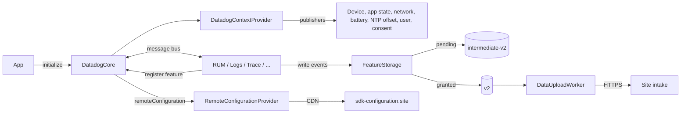

# Core Feature

## Overview

Core (`DatadogCore`) is the SDK entry point. `Datadog.initialize()` creates an SDK instance that every product (RUM, Logs, Trace, Session Replay, Crash Reporting, Profiling, Flags, WebView Tracking) registers into. Core owns what products share: the client token, site, `env`, service and version, tracking consent, user and account info, on-disk batching, upload scheduling, data encryption, NTP time sync and remote configuration.

Core must be initialized before enabling any product. Products enabled before `Datadog.initialize()`, or in an instance name that was never initialized, do nothing.

**Platform**: iOS, tvOS, watchOS, visionOS. macOS and Mac Catalyst builds compile but are not officially supported; `Datadog.initialize()` prints a warning on them.

## Quick Start Example

```swift
import Foundation
import DatadogCore

// Optional: print SDK internal messages at this level or above. Default: nil (silent).
Datadog.verbosityLevel = .debug

Datadog.initialize(
    with: Datadog.Configuration(
        // Datadog client token (not an API key). Must not be empty.
        clientToken: "<client_token>",
        // Environment name, e.g. "staging". Letters, digits and `_:./-`, max 196 characters, cannot end with `:`.
        env: "<environment>",
        // Datadog site. Default: .us1.
        site: .eu1,
        // Service name. Default: nil (app bundle identifier, or "ios" if none).
        service: "com.example.app",
        // App version for Unified Service Tagging. Default: nil (CFBundleShortVersionString, then CFBundleVersion).
        version: "1.2.3",
        // Bundle used to read app info. Default: .main.
        bundle: .main,
        // Batch maturity before upload: .small, .medium, .large. Default: .medium.
        batchSize: .medium,
        // Upload cadence: .frequent, .average, .rare. Default: .average.
        uploadFrequency: .average,
        // URLSession connectionProxyDictionary for all uploads. Default: nil.
        proxyConfiguration: nil,
        // On-disk encryption, conforming to `DataEncryption`. Default: nil (stored unencrypted).
        encryption: MyDataEncryption(),
        // Custom NTP clock, conforming to `ServerDateProvider`. Default: nil (Datadog NTP pools via Kronos).
        serverDateProvider: nil,
        // Max batches uploaded back to back per cycle: .low (5), .medium (20), .high (100). Default: .medium.
        batchProcessingLevel: .medium,
        // Keep uploading in the background: UIApplication background tasks in apps (up to ~30 s),
        // ProcessInfo activities in app extensions and on watchOS. Default: false. Not available on macOS.
        backgroundTasksEnabled: false,
        // Fetch SDK settings from the Datadog CDN. Default: nil (no fetch).
        remoteConfiguration: Datadog.Configuration.RemoteConfiguration(id: "<remote_config_id>", customURL: nil)
    ),
    // Initial consent: .granted, .notGranted or .pending.
    trackingConsent: .pending,
    // Instance name. Must stay stable between launches (it names the data folder). Default: the default instance.
    instanceName: CoreRegistry.defaultInstanceName
)

// Enable products after this point, e.g. RUM.enable(with:), Logs.enable(with:).

// Update consent at any time.
Datadog.set(trackingConsent: .granted)

// User and account info, added to logs, traces and RUM events.
Datadog.setUserInfo(id: "user-123", name: "Jane", email: "jane@example.com", extraInfo: ["plan": "premium"])
Datadog.addUserExtraInfo(["beta": true])
Datadog.setAccountInfo(id: "account-1", name: "Acme", extraInfo: ["tier": "gold"])
Datadog.addAccountExtraInfo(["region": "eu"])
Datadog.clearUserInfo()
Datadog.clearAccountInfo()

// Delete unsent data of the products enabled in this instance; the instance keeps running.
// Call it after enabling products: data of products not enabled yet in this launch is kept.
Datadog.clearAllData()

// Optional: a second, independent SDK instance. `initialize` returns it; pass it to products
// and `Datadog` calls with `in:`. Calls without `in:` target the default instance.
let secondary = Datadog.initialize(
    with: Datadog.Configuration(clientToken: "<other_client_token>", env: "<environment>"),
    trackingConsent: .granted,
    instanceName: "secondary"
)
// Logs.enable(with: Logs.Configuration(), in: secondary)
Datadog.setUserInfo(id: "user-123", in: secondary)

// Look up and stop instances by name.
let isRunning = Datadog.isInitialized(instanceName: "secondary")
let sameInstance = Datadog.sdkInstance(named: "secondary")
Datadog.stopInstance(named: "secondary")
```

## Architecture Overview



- `Datadog.initialize()` runs synchronously on the main thread, validates the token and `env`, creates the instance and registers it in `CoreRegistry` under its name.
- Each product registers a feature with its own storage and upload units, and writes events as batch files on disk (see [On-Disk Layout](#on-disk-layout)).
- Upload workers read mature batches, check upload conditions, and send them to the site's intake. Features communicate with each other through Core's message bus (for example RUM context for Logs and Trace).
- Internals for SDK contributors (storage pipeline, context, message bus, thread-safety rules) are in [`docs/ARCHITECTURE.md`](../docs/ARCHITECTURE.md). SDK overhead measurements are in [`docs/sdk_performance.md`](../docs/sdk_performance.md).

## Key Files

### Feature Entry Point
- `DatadogCore/Sources/Datadog.swift` — `initialize`, consent, user and account info, instance management, init validation.
- `DatadogCore/Sources/DatadogConfiguration.swift` — `Datadog.Configuration`, `BatchSize`, `UploadFrequency`, `BatchProcessingLevel`, `RemoteConfiguration`.

### Public API
- `DatadogCore/Sources/Datadog+objc.swift` — Objective-C `DDDatadog`, `DDTrackingConsent`.
- `DatadogCore/Sources/DatadogConfiguration+objc.swift` — Objective-C `DDConfiguration`, `DDSite`, `DDBatchSize`, `DDUploadFrequency`, `DDBatchProcessingLevel`, `DDDataEncryption`, `DDServerDateProvider`, `DDRemoteConfiguration`.
- `DatadogCore/Sources/Core/Storage/DataEncryption.swift` — `DataEncryption` protocol.
- `DatadogCore/Sources/Core/Context/ServerOffsetPublisher.swift` — `ServerDateProvider` protocol and the default NTP provider.
- `DatadogCore/Sources/NetworkInstrumentation/URLSessionInstrumentation+objc.swift` — Objective-C `URLSessionInstrumentation` (duration breakdown).
- `DatadogCore/Sources/Extensions/CrossPlatformExtension.swift`, `DatadogCore/Sources/Extensions/ContextSharing/SharedContext.swift` — `@_spi(Internal)` shared context for cross-platform SDKs.
- `DatadogInternal/Sources/Context/TrackingConsent.swift` — `TrackingConsent`.
- `DatadogInternal/Sources/Context/DatadogSite.swift` — `DatadogSite`, intake hosts and the remote configuration CDN host.
- `DatadogInternal/Sources/CoreRegistry.swift` — `CoreRegistry`, the registry of named instances (`defaultInstanceName`).
- `DatadogInternal/Sources/Telemetry/CoreLogger.swift` — `CoreLoggerLevel`, the values of `Datadog.verbosityLevel`.
- `DatadogCore/Sources/Datadog+Internal.swift` — `@_spi(Internal)` APIs used by cross-platform SDKs.

### Implementation
- `DatadogCore/Sources/PerformancePreset.swift` — Batch sizes, file ages, upload delays, storage limits.
- `DatadogCore/Sources/Core/DatadogCore.swift` — Core instance, feature registry, consent changes, stop and flush.
- `DatadogCore/Sources/Core/Context/DatadogContextProvider.swift` — Shared context and its publishers.
- `DatadogCore/Sources/Core/Storage/FeatureStorage.swift` — Writers per consent, consent migration.
- `DatadogCore/Sources/Core/Storage/Directories.swift` — Data folder layout.
- `DatadogCore/Sources/Core/Storage/FilesOrchestrator.swift` — File rotation, age limits, directory size limit.
- `DatadogCore/Sources/Core/Upload/DataUploadWorker.swift` — Upload loop and error reporting.
- `DatadogCore/Sources/Core/Upload/DataUploadConditions.swift` — Network, battery and Low Power Mode blockers.
- `DatadogCore/Sources/Core/Upload/DataUploadStatus.swift` — Status codes that retry or drop a batch.
- `DatadogCore/Sources/Core/Upload/BackgroundTaskCoordinator.swift` — Background task handling.
- `DatadogCore/Sources/Core/RemoteConfigurationProvider.swift` — Remote configuration fetch and cache.

## Configuration Categories

### Identity and Endpoints
- `clientToken` and `env` are validated at init. An empty token or an invalid `env` aborts initialization.
- `site` selects the intake host, for example `browser-intake-datadoghq.eu` for `.eu1`. Sites: `.us1`, `.us3`, `.us5`, `.eu1`, `.ap1`, `.ap2`, `.uk1`, `.us1_fed`, `.us2_fed`.
- `service` defaults to the bundle identifier. `version` defaults to `CFBundleShortVersionString`, then `CFBundleVersion`, then `"0.0.0"`.
- `proxyConfiguration` applies to every upload and to remote configuration fetches.

### Tracking Consent
| Consent | Behavior |
|---|---|
| `.granted` | Events are written to the upload folder and sent. |
| `.pending` | Events are written to an intermediate folder and not uploaded. |
| `.notGranted` | Events are dropped without being written. |

- Changing from `.pending` to `.granted` moves pending data to the upload folder. Changing to `.notGranted` deletes pending data.
- Pending data does not survive a relaunch: enabling a product deletes its `intermediate-v2` batches, whatever the initial consent.
- Consent does not affect data already in the upload folder.

### Batching and Upload
- `batchSize` sets how long a batch file stays open: about 3 s (`.small`), 10 s (`.medium`) or 35 s (`.large`). App extensions always use 1 s.
- `uploadFrequency` sets the base delay between upload checks: 0.5 s (`.frequent`), 2 s (`.average`) or 5 s (`.rare`). The first check runs within about 1 s of `initialize` (random jitter), so mature batches from a previous launch upload right away. If it finds nothing, the next check waits 5x the base delay. Afterwards, the delay grows by 10% after each check with nothing to send, a blocked upload or a retry, up to 10x, and goes back to 1x once all batches are sent.
- `batchProcessingLevel` caps the batches uploaded back to back in one cycle.
- Storage limits: 5 MB per batch file, 1,000 events per file, 1 MB per event (larger events are dropped), 512 MB per consent folder (`v2` and `intermediate-v2` each, so up to about 1 GB per feature; oldest files deleted first). Files older than 18 hours are deleted without upload. These are defaults; some products override them: RUM keeps files 24 hours, Session Replay 12 hours (resources 48 hours) with 10 MB per event, and Profiling allows 15 MB per event.
- Uploads are skipped while the network is unreachable (not checked on watchOS), when battery is at 10% or below and not charging, or in Low Power Mode.
- Responses 408, 429, 500, 502, 503, 504, 507 and network errors keep the batch for retry. 202, 400, 401, 403 and 413 delete it. 401 and 403 also log "Make sure that the provided token still exists and you're targeting the relevant Datadog site."
- `backgroundTasksEnabled` lets uploads continue in the background, with `UIApplication.beginBackgroundTask` in apps and `ProcessInfo.beginActivity` in app extensions and on watchOS. Tasks end when nothing is left to upload or an upload is blocked.

### Encryption
`encryption` encrypts each event before it is written to disk and decrypts it before upload. Decryption must work across launches: events that fail to decrypt are not uploaded, and the SDK logs "Failed to decrypt data".

### Time Synchronization
By default the SDK computes a server time offset with Datadog NTP pools (`0-3.datadog.pool.ntp.org`, via Kronos) and applies it to event dates. A custom `serverDateProvider` replaces this; a no-op provider leaves device time uncorrected, which can shift RUM sessions and traces.

### Remote Configuration
- With `remoteConfiguration`, Core loads the cached document from `Library/Application Support` at init, then fetches it from `https://sdk-configuration.<site host>/` (or `customURL`) in the background. On UIKit platforms it fetches again when the app returns to the foreground, at most once every 5 minutes (an earlier foreground is ignored). Unchanged documents return 304 via ETag.
- RUM, Trace, Session Replay and Profiling apply the document once, at their `enable` call, on top of the in-code configuration. Values fetched after `enable` apply on the next launch.
- RUM reads the `rum` and `trace` namespaces (sample rates, tracking flags, thresholds, traced hosts), Trace reads the trace sample rate, Session Replay reads its sample rate and privacy levels, and Profiling reads the `profiling` namespace (app launch and continuous sample rates).

### Debugging
- `Datadog.verbosityLevel` (`.debug`, `.warn`, `.error`, `.critical`) prints SDK messages to the console. Errors such as a failed `initialize` always print.
- The `DD_DEBUG` launch argument sets verbosity to `.debug`, forces `.small` batches and `.frequent` uploads, and overrides product sample rates. Remove it from release schemes.

## Lifecycle and Storage

### Startup Order
1. `Datadog.initialize()` validates the configuration, creates the instance folder and context, deletes SDK v1 folders, and loads the cached remote configuration document if `remoteConfiguration` is set. The fresh document is fetched in the background.
2. Each product's `enable` registers its feature and reads its configuration once, including the remote configuration available at that moment. Enabling a product before `initialize`, or twice, does not work: `enable` before `initialize` does nothing, and Session Replay and Profiling keep the first instance.
3. Events go to disk according to the current consent. User and account info, consent and other context changes apply to events written after the call, so set them as early as possible.
4. The first upload check runs within about 1 s, and uploads batches left from a previous launch. New batches become uploadable once they mature (`batchSize`); if the first check found nothing, the next one waits 5x the `uploadFrequency` delay.
5. When the app goes to the background, `backgroundTasksEnabled: true` only lets an upload that is already in progress finish. It does not keep upload checks running while the app is suspended; they resume on the next foreground or launch.

### On-Disk Layout
| Path | Content |
|---|---|
| `Library/Caches/com.datadoghq/v2/<hash>/` | Instance folder. `<hash>` is the SHA-256 of the instance name and site. |
| `.../<hash>/<feature>/v2/` | Batches ready for upload (consent `.granted`). |
| `.../<hash>/<feature>/intermediate-v2/` | Batches waiting for consent (`.pending`). |
| `Library/Application Support/com.datadoghq/v2/<hash>/<id>.json` | Cached remote configuration document. Stored outside Caches so purges don't remove it. |

- `<feature>` is the feature name, for example `rum`, `logging`, `tracing`, `session-replay`, `session-replay-resources`.
- Batch file names are their creation time in milliseconds since the reference date (2001-01-01). Files are TLV-encoded, and encrypted per event when `encryption` is set.
- On macOS the path starts with the app's own folder: `Library/Caches/<bundle id>/com.datadoghq/...`.
- Debugging: download the app container from Xcode (Devices and Simulators) or open the simulator's data folder. Files in `intermediate-v2` mean consent is still pending; files piling up in `v2` mean uploads are blocked or failing. An empty folder is normal once uploads succeed, since uploaded batches are deleted; to check that events are written, look while the device is offline, or set `Datadog.verbosityLevel = .debug` and watch for "Uploading batches..." in the console.
- Changing the instance name or site changes `<hash>`. Data in the old folder is not uploaded.

### Multiple Instances
- Each instance has its own folder, consent, context (user, account, service, env), products and uploads. Instances can use different client tokens and sites.
- Every `Datadog` method and product `enable` defaults to the default instance. A product enabled in one instance does not see events or context from another.
- Session Replay and Profiling support only one instance: enabling them in a second instance logs an error and the first one keeps running.
- Objective-C APIs take an `instanceName:` string instead of the instance object.

## Common Troubleshooting Patterns

### "No data in Datadog at all"
**Causes:**
- `initialize` failed: empty token, invalid `env`, or the instance name is already initialized. It prints an error and returns a no-op instance.
- Consent is `.pending` or `.notGranted`.
- Wrong `site` for the org, or the client token was revoked (401/403 in logs).
- Products enabled before `initialize`, or in a different instance.
- Uploads blocked by Low Power Mode, low battery or no network.

**Solutions:** Set `Datadog.verbosityLevel = .debug`, check for SDK errors, confirm consent is `.granted`, and check the site matches the Datadog URL the org uses.

### "Data arrives late or in bursts"
**Causes:** Batches upload only after they mature (`batchSize`) and on the upload schedule (`uploadFrequency`). When the app is suspended, uploads stop until the next launch or foreground unless `backgroundTasksEnabled` is set.

**Solutions:** Use `.small` and `.frequent` for testing, enable background tasks, or keep the app in the foreground for a few seconds before closing it.

### "Data collected before consent was granted is missing"
**Causes:** Consent was `.notGranted` at that time (events dropped), or changed to `.notGranted` before `.granted` (pending data deleted), or the app was relaunched while consent was `.pending` (pending data is deleted when each product is enabled).

**Solutions:** Use `.pending` until the user decides, then set `.granted`.

### "Events have the wrong service, env or version"
**Causes:** Defaults come from the bundle passed as `bundle`. Cross-platform SDKs can override `version` and source through internal configuration.

**Solutions:** Set `service`, `env` and `version` explicitly.

### "Some events are missing in high-volume apps"
**Causes:** Events over the size limit (1 MB by default) are dropped; a consent folder (`v2` or `intermediate-v2`) over 512 MB deletes its oldest files; offline periods longer than the retention window (18 hours by default, 24 hours for RUM, 12 hours for Session Replay) expire files.

**Solutions:** Reduce event size (large attributes), and check how long devices stay offline.

### "Event timestamps are shifted"
**Causes:** A custom or no-op `serverDateProvider`, or NTP unreachable, so no offset is applied and the device clock is used.

**Solutions:** Keep the default provider, and allow NTP traffic on restricted networks.

### "Remote configuration changes don't apply"
**Causes:** Products read remote configuration only at `enable`. A document fetched after that applies on the next launch. Only RUM, Trace, Session Replay and Profiling read it.

**Solutions:** Relaunch the app after the change, and check the configuration ID and `customURL`.

## Feature Interactions

- **All products**: register into a Core instance and use its context (service, env, version, user, account, consent, network, battery). User and account info are added to logs, traces and RUM events.
- **RUM**: `clearUserInfo()` and `clearAccountInfo()` also empty the user or account on the active RUM session and view. `clearUserInfo()` keeps the anonymous ID, so with `trackAnonymousUser` (on by default) events still carry `usr.anonymous_id`. Stop the session or view first to keep it.
- **Multiple instances**: see [Multiple Instances](#multiple-instances).
- **Shared APIs owned by Core**: user and account info, tracking consent and the configuration options above are documented here. When they change, also check the docs that describe their effect on events: `DatadogRUM/RUM_FEATURE.md`, `DatadogLogs/LOGS_FEATURE.md`, `DatadogTrace/TRACE_FEATURE.md`.
- **Cross-platform SDKs**: bridges such as React Native and Kotlin Multiplatform set source, version and SDK version through `additionalConfiguration`, and read user and account IDs with `@_spi(Internal)` `CrossPlatformExtension.subscribe(toSharedContext:)`.
- **Network instrumentation**: `URLSessionInstrumentation.enableDurationBreakdown(with:)` is documented in `DatadogRUM/RUM_FEATURE.md` and `DatadogTrace/TRACE_FEATURE.md`.

## Additional Context

- **Objective-C**: `DDDatadog` mirrors the Swift API. `DDConfiguration(clientToken:env:)` exposes options as properties, with `setEncryption`, `setServerDateProvider` and `setRemoteConfiguration` setters. `additionalConfiguration` is public there for cross-platform SDKs and is not a supported customer API.
- **Deprecated**: Objective-C `DDURLSessionInstrumentation` `enable(configuration:)` and `enable(configuration:instanceName:)`. Use `enableDurationBreakdown(with:)` and `enableDurationBreakdown(with:instanceName:)`.
- `Datadog.flushAndDeinitialize()` exists only in test builds (`DD_SDK_COMPILED_FOR_TESTING`). `Datadog.flush()` is `@_spi(Internal)`.
- `stopInstance` stops every feature in the instance and unregisters it; a new `initialize` with the same name is then allowed. `clearAllData` deletes unsent data of the products currently enabled in the instance and keeps it running. Batches of a product not yet enabled in this launch stay on disk; once it is enabled, granted batches upload and pending batches (`intermediate-v2`) are deleted.
- App extensions use shorter batches (1 s) and faster first uploads, since extensions are short-lived.
- There is no option to block SDK startup until a remote configuration is cached. It's planned (the `remoteConfiguration` doc comment mentions a `requireRemoteConfiguration` flag) but doesn't exist yet.
- At init, Core deletes data folders left by SDK v1 (`com.datadoghq.logs`, `.traces`, `.rum`).
