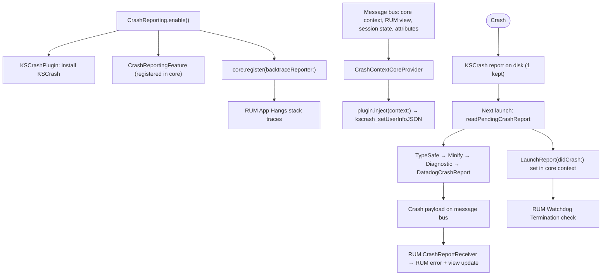

# Crash Reporting Feature

## Overview

Crash Reporting captures fatal crashes with [KSCrash](https://github.com/kstenerud/KSCrash), stores the report on disk, and sends it to Datadog **as a RUM error** on the next app launch. It also provides the stack trace generator RUM uses for App Hangs, and the "did the previous process crash?" signal RUM needs for Watchdog Terminations.

Crash Reporting has no upload path of its own. Crash reports reach Datadog only through RUM, so **RUM must be enabled**. Crash Reporting requires initialization via `Datadog.initialize()` before enabling.

**Platform**: iOS, tvOS, watchOS, visionOS, macOS (Swift Package Manager only) — with platform-specific limitations:
- **iOS / tvOS / visionOS**: Fatal signals (including Swift runtime traps such as `fatalError()` and force-unwrapping `nil`, and Mach exceptions such as `EXC_BAD_ACCESS`, which the kernel delivers as signals), uncaught `NSException`s, and uncaught C++ exceptions.
- **macOS**: Fatal signals, Mach exceptions and uncaught C++ exceptions, as on iOS. AppKit catches `NSException`s raised on the main thread while it handles an event, logs them and keeps the app running, so they are not reported unless the app sets the `NSApplicationCrashOnExceptions` user default to `true`. Each app keeps its crash reports in its own `~/Library/Caches/<bundle identifier>` subdirectory, since apps that are not sandboxed share `~/Library/Caches`. Watchdog terminations are not reported.
- **watchOS**: Only uncaught `NSException`s and C++ exceptions. KSCrash compiles out its signal monitor on watchOS (`KSCRASH_HAS_SIGNAL` is `0`), so signal-based crashes, including Swift runtime traps, are **not** captured. Stack traces of other threads and App Hang stack traces are unavailable (`KSCrashBacktrace` returns `nil`).

## Quick Start Example

```swift
import DatadogCore
import DatadogCrashReporting
import DatadogRUM

// 1. Initialize Core SDK first
Datadog.initialize(
    with: Datadog.Configuration(
        clientToken: "<client_token>",
        env: "<environment>"
    ),
    trackingConsent: .granted
)

// 2. Enable RUM before Crash Reporting (required: crashes are sent as RUM errors)
// Crash Reporting reads the pending crash report asynchronously as soon as it is enabled,
// so RUM must already be registered to receive it.
RUM.enable(
    with: RUM.Configuration(
        applicationID: "<rum_application_id>",
        // Optional: report App Hangs; their stack traces come from Crash Reporting
        appHangThreshold: 0.25,
        // Optional: report Watchdog Terminations; requires Crash Reporting (unavailable on macOS)
        trackWatchdogTerminations: true
    )
)

// 3. Enable Crash Reporting right after RUM, as early as possible in app launch
CrashReporting.enable(
    with: CrashReporting.Configuration(
        // Generate stack traces for App Hangs detected by RUM
        // Set to false to keep App Hang errors without stack traces
        // Crash reports and all other stack traces are unaffected
        // Default: true
        appHangBacktraceEnabled: true
    )
)

// Shorthand with the default configuration:
// CrashReporting.enable()
```

### Custom Plugin (Advanced)

`CrashReporting.enable(with:configuration:in:)` accepts a `CrashReportingPlugin` that replaces KSCrash. The plugin's types (`DDCrashReport`, `BacktraceReporting`) live in `DatadogInternal`, so an implementation must import it:

```swift
import Foundation
import DatadogCrashReporting
import DatadogInternal

final class MyCrashReportingPlugin: CrashReportingPlugin {
    func readPendingCrashReport(completion: @escaping (DDCrashReport?) -> Bool) {
        // Load the persisted report, if any. Purge it when `completion` returns `true`.
        _ = completion(nil)
    }

    func inject(context: Data) {
        // Persist `context` so it is attached to the next crash report as `DDCrashReport.context`.
    }

    // Return `nil` if the plugin cannot generate backtraces (App Hangs are then reported without stack traces).
    var backtraceReporter: BacktraceReporting? { nil }
}

CrashReporting.enable(with: MyCrashReportingPlugin(), configuration: CrashReporting.Configuration())
```

### Objective-C

```objc
@import DatadogCrashReporting;

DDCrashReporterConfiguration *configuration = [DDCrashReporterConfiguration new];
configuration.appHangBacktraceEnabled = NO;
[DDCrashReporter enableWith:configuration];

// or, with the default configuration:
[DDCrashReporter enable];
```

The Objective-C API has no custom plugin or custom core instance overload.

## Architecture Overview



1. **Install**: `CrashReporting.enable()` runs synchronously on the main thread. It installs KSCrash, registers `CrashReportingFeature` in core, and registers the plugin's `backtraceReporter` (if any) in core.
2. **Context injection**: `CrashContextCoreProvider` listens on the message bus for core context updates, the last RUM view event, RUM session state, RUM and Logs global attributes, and RUM session stop and view reset messages. Each change produces a JSON-encoded `CrashContext` that is injected into KSCrash, so it is written alongside a future crash.
3. **Crash**: KSCrash writes the report to `Library/Caches/com.datadoghq.crash-reporting/v2`. Only the most recent report is kept.
4. **Next launch**: `sendCrashReportIfFound()` reads the pending report on a background queue, decodes its `CrashContext`, and sends a `Crash` payload on the message bus. It also sets `LaunchReport(didCrash:)` in core context.
5. **RUM**: `CrashReportReceiver` turns the `Crash` into a RUM error (`error.is_crash: true`, `error.category: Exception`) and attaches it to the right session and view (see [Linking Crashes to RUM Sessions](#linking-crashes-to-rum-sessions)).

## Key Files

### Feature Entry Point
- **`DatadogCrashReporting/Sources/CrashReporting.swift`** — `CrashReporting.enable(...)` overloads and `CrashReporting.Configuration`. Also defines the Objective-C bridge (`DDCrashReporter`, `DDCrashReporterConfiguration`).

### Public API
- **`DatadogCrashReporting/Sources/CrashReportingPlugin.swift`** — `CrashReportingPlugin` protocol, for replacing KSCrash with a custom crash reporter.

### Plugin Contract Types (in `DatadogInternal`)
These types are `public` in `DatadogInternal` because `CrashReportingPlugin` uses them, but `DatadogInternal` is not a supported customer import and the types are not re-exported (they do not appear in `api-surface-swift`). They matter only to custom plugin authors and SDK contributors.
- **`DatadogInternal/Sources/Models/CrashReporting/DDCrashReport.swift`** — `DDCrashReport`: `date`, `type`, `message`, `stack`, `threads`, `binaryImages`, `meta`, `wasTruncated`, `context`, `additionalAttributes`.
- **`DatadogInternal/Sources/Models/CrashReporting/BacktraceReport.swift`** — `BacktraceReport`, returned by `BacktraceReporting.generateBacktrace(threadID:)`.
- **`DatadogInternal/Sources/Models/CrashReporting/CrashContext.swift`** — `CrashContext`: app and device state captured at crash time.
- **`DatadogInternal/Sources/Models/CrashReporting/CrashReportingConfiguration.swift`** — protocol RUM uses to read `appHangBacktraceEnabled` without importing `DatadogCrashReporting`.

### Implementation
- **`DatadogCrashReporting/Sources/CrashReportingFeature.swift`** — Feature. Reads pending reports, injects context, exposes `appHangBacktraceEnabled` through `CrashReportingConfiguration`.
- **`DatadogCrashReporting/Sources/CrashContextProvider.swift`** — Builds `CrashContext` from message bus updates.
- **`DatadogCrashReporting/Sources/CrashReportSender.swift`** — Sends the `Crash` payload on the message bus. Drops reports recorded without `.granted` consent.
- **`DatadogCrashReporting/Sources/KSCrashIntegration/KSCrashPlugin.swift`** — Default plugin. KSCrash install configuration: monitors, storage path, report count.
- **`DatadogCrashReporting/Sources/KSCrashIntegration/KSCrashBacktrace.swift`** — Thread backtrace generation for App Hangs (`nil` on watchOS).
- **`DatadogCrashReporting/Sources/KSCrashIntegration/DatadogMinifyFilter.swift`** — Keeps at most 200 stack frames and sets `wasTruncated`.
- **`DatadogCrashReporting/Sources/KSCrashIntegration/DatadogDiagnosticFilter.swift`** — Builds the crash type and message (signal names, exception reasons).
- **`DatadogCrashReporting/Sources/KSCrashIntegration/DatadogCrashReportFilter.swift`** — Converts a KSCrash report into a `DDCrashReport`.
- **`DatadogRUM/Sources/Integrations/CrashReportReceiver.swift`** — RUM-side consumer that turns crashes into RUM errors and view updates.
- **`DatadogRUM/Sources/FatalErrorBuilder.swift`** — Builds RUM error and view events for crashes and fatal App Hangs.

## Configuration Categories

### App Hang Stack Traces
- **`appHangBacktraceEnabled`** (default: `true`) — When `false`, RUM still reports App Hang errors, without a stack trace. The stack trace is captured while the main thread is still blocked, so its cost adds to the measured hang duration. Disabling it matters most for apps using a small `RUM.Configuration.appHangThreshold`. Crash reports are unaffected.
- RUM reads this setting on each hang, so it applies whichever feature is enabled first. Crash delivery still requires RUM to be enabled first. See ["Crashes not appearing in Datadog"](#crashes-not-appearing-in-datadog).

### Custom Plugin
- `CrashReporting.enable(with: plugin)` and `CrashReporting.enable(with: plugin, configuration:)` replace KSCrash. See [Custom Plugin](#custom-plugin-advanced).
- The SDK calls `readPendingCrashReport(completion:)` and `inject(context:)` on a background thread, and those calls are serialized.
- `backtraceReporter` is read once, synchronously on the main thread, during `CrashReporting.enable()`. Keep it cheap: expensive work there delays app launch.

### Fixed Behavior (not configurable)
- KSCrash monitors: `.signal`, `.cppException`, `.nsException`, `.system` (`.system` collects device and app info; it is not a crash monitor). The Mach exception monitor is disabled on purpose. Datadog relies on BSD signals instead.
- KSCrash's `__cxa_throw` swapping is disabled, as it could terminate the process in some setups ([#2659](https://github.com/DataDog/dd-sdk-ios/issues/2659)). C++ exceptions are still captured through the terminate handler.
- One crash report is stored at a time. Stack traces are capped at 200 frames.

## Linking Crashes to RUM Sessions

On the next launch, `CrashReportReceiver` decides where the crash goes, based on the `CrashContext` captured at crash time:

1. **Session was stopped**: The crash happened after `RUMMonitor.stopSession()` and before a new view started. It is dropped.
2. **A view was active**:
   - If the last view already has a crash (`view.crash.count > 0`, for example one reported by a cross-platform SDK), the native crash is dropped to avoid duplicates.
   - If the crash is less than **4 hours** old, it is attached to that view and the view is updated (`view.crash.count`, `view.is_active: false`).
   - Otherwise only the RUM error is sent, still linked to that view and session. The view itself is not updated, because the backend considers it stale.
3. **A session existed but no view was active**: The crash is sent in that session, following the RUM off-view rules:
   - It goes to a new "ApplicationLaunch" view if the app was in the foreground and no view had been tracked yet in this initial session.
   - It goes to a new "Background" view if the app was in the background and `trackBackgroundEvents` is `true`.
   - On macOS, which has no background state, it goes to a new "NoActiveView" view once a view has been tracked.
   - Otherwise it is dropped. This includes a sampled-out session, and a foreground crash between views.
4. **No RUM session existed yet**: A new session is sampled with `RUM.Configuration.sessionSampleRate`. If sampled in, the crash goes to an "ApplicationLaunch" (foreground) or "Background" (background, with `trackBackgroundEvents`) view.

`errorEventMapper` and `viewEventMapper` apply to these events. Dropping a crash is not supported: if `errorEventMapper` returns `nil`, the unmodified error is sent and a warning is logged.

## dSYM Upload (Symbolication)

Crash stack traces are collected as raw addresses. Datadog symbolicates them using the `.dSYM` files uploaded for the build, matched by build UUID. Upload options:
- **datadog-ci**: `npx @datadog/datadog-ci dsyms upload <folder-or-zip>` with `DATADOG_API_KEY` (and `DATADOG_SITE` for non-US1 sites). See [datadog-ci dSYMs](https://github.com/DataDog/datadog-ci/blob/master/packages/datadog-ci/src/commands/dsyms/README.md).
- **Fastlane**: [`fastlane-plugin-datadog`](https://github.com/DataDog/datadog-fastlane-plugin) (`fastlane add_plugin datadog`), action `upload_symbols_to_datadog(api_key:, dsym_paths:, site:)`. Used after `download_dsyms`, it picks up the downloaded `dsym_paths` automatically.
- **GitHub Actions**: [`DataDog/upload-dsyms-github-action`](https://github.com/DataDog/upload-dsyms-github-action) (`uses: DataDog/upload-dsyms-github-action@v1`, inputs `api_key`, `site`, `dsym_paths`, `dry_run`).

`datadog-ci dsyms upload` runs only on macOS, so the GitHub Action needs a macOS runner (`runs-on: macos-latest`), and CI jobs on Linux cannot upload dSYMs.

Symbolication is supported only for crashes on physical devices, not on simulators. Each `.dSYM` file is limited to 2 GB. Re-uploading a `.dSYM` for the same app version does not override the existing one.

## Common Troubleshooting Patterns

### "Crashes not appearing in Datadog"
1. Crash reports are sent on the **next launch**. The app must be relaunched after the crash, and `CrashReporting.enable()` must run again.
2. The Xcode debugger was attached when the crash happened. It catches the crash before KSCrash does. Reproduce without the debugger attached.
3. RUM is not enabled. The console shows `In order to use Crash Reporting, RUM feature must be enabled`.
4. RUM was enabled after Crash Reporting. The report is read on a background queue as soon as `CrashReporting.enable()` returns, and the message bus does not buffer. If RUM is not registered by the time the `Crash` payload is sent, the crash is dropped and the report is already purged. Calling `RUM.enable()` right after `CrashReporting.enable()` does not close this race. Call `RUM.enable()` **before** `CrashReporting.enable()`.
5. Tracking consent was not `.granted` when the crash happened (for example `.pending` before the user accepts). The report is dropped, even if consent is granted later ([#1701](https://github.com/DataDog/dd-sdk-ios/issues/1701)).
6. The crash was dropped by RUM: sampled-out session, `stopSession()`, a background crash with `trackBackgroundEvents: false`, or a duplicate of a crash already on the view. See [Linking Crashes to RUM Sessions](#linking-crashes-to-rum-sessions).
7. watchOS: signal-based crashes (Swift runtime traps, `EXC_BAD_ACCESS`) are not captured.
8. `CrashReporting.enable()` was called before `Datadog.initialize()`. The console shows `Datadog SDK must be initialized before calling CrashReporting.enable().`
9. Another crash reporter is installed. See ["Using Datadog with another crash reporter"](#using-datadog-with-another-crash-reporter-firebase-crashlytics-sentry-bugsnag-etc).

### "Warning: RUM feature must be enabled, but RUM is enabled"
The warning is logged whenever no message bus receiver accepts the `Crash` payload. `CrashReportReceiver` also rejects it when the crash is a duplicate of one already on the last view, or when no session existed and the new session is sampled out. In those cases the warning is misleading. RUM is enabled, and the crash was dropped on purpose.

### Using Datadog with another crash reporter (Firebase Crashlytics, Sentry, Bugsnag, etc.)
Running two crash reporters in one process is not guaranteed to work. Signal handlers, the `NSException` handler, and the C++ terminate handler are each a single process-wide slot. Whether both reporters receive a crash depends on install order and on whether each one forwards to the handler it replaced.
- **What Datadog does**: KSCrash saves the previous handlers when it installs. After writing its report, it restores the previous signal handlers and re-raises the signal, calls the previous `NSUncaughtExceptionHandler`, and calls the original C++ terminate handler. A reporter installed **before** Datadog keeps receiving crashes.
- **What can break it**:
  - A reporter installed **after** Datadog sees crashes first. If it does not forward to the previous handlers, or exits the process itself, Datadog never sees the crash.
  - Reporters that use **Mach exception handlers** see a Mach exception before the kernel turns it into a signal. If they terminate the process at that point, Datadog's signal handler never runs.
- **Recommendation**: Datadog does not support or test combinations with other crash reporters. If both must run, enable Datadog Crash Reporting **last**, so it sees crashes first and forwards them. Then check both tools with a test crash (`fatalError()`, debugger detached).
- **Another KSCrash installation** (the app or another SDK using the shared `KSCrash` instance without renamed symbols): Datadog logs `DatadogCrashReporting error: crash reporting is already installed`. It reuses the existing installation without its own configuration and filters, so the reports it reads are not `DDCrashReport`s. They fail to load and are deleted. This setup is not supported. Calling `CrashReporting.enable()` a second time also logs this warning, which is harmless in that case.

### "Crash stack traces are not symbolicated"
Crashes from simulators are never symbolicated. Reproduce on a physical device. Otherwise, upload the `.dSYM` files of the exact build that crashed. See [dSYM Upload](#dsym-upload-symbolication). For App Store builds, download the dSYMs from App Store Connect, or use Fastlane `download_dsyms`.

### "Crash appears on an unexpected view or session"
See [Linking Crashes to RUM Sessions](#linking-crashes-to-rum-sessions). Crashes reported more than 4 hours after they happened are sent as an error without updating the view.

### "App Hang errors have no stack trace"
1. Crash Reporting is not enabled (no backtrace reporter is registered).
2. `appHangBacktraceEnabled` is `false`.
3. watchOS: App Hang stack traces are not available.

### "Watchdog Terminations are never reported"
`trackWatchdogTerminations` requires Crash Reporting. The watchdog check waits for the `LaunchReport` that only Crash Reporting sets in core context. Without it, the check never runs.

### "App Hang stack-trace opt-out was undone"
Calling `CrashReporting.enable()` again, for example from a cross-platform wrapper, replaces the feature and its configuration. When a later call turns App Hang stack traces back on, the SDK logs a warning. Pass the same configuration to every `enable` call.

## Feature Interactions

- **RUM (required)**: Receives `Crash` payloads and writes RUM errors with `error.is_crash`, `error.type`, `error.message`, `error.stack`, `error.threads`, `error.binary_images`, `error.meta`, and `error.was_truncated`. Session sampling, `trackBackgroundEvents`, `stopSession()`, and the error and view event mappers all affect crash reporting. See [Linking Crashes to RUM Sessions](#linking-crashes-to-rum-sessions).
- **RUM App Hangs**: When `RUM.Configuration.appHangThreshold` is set, RUM gets main-thread stack traces from the backtrace reporter that Crash Reporting registers, unless `appHangBacktraceEnabled` is `false`.
- **RUM Watchdog Terminations**: `trackWatchdogTerminations` needs Crash Reporting. RUM reads `LaunchReport.didCrash` to rule out a crash before reporting a watchdog termination. Watchdog termination errors carry no stack trace.
- **Logs**: Crash Reporting keeps the last Logs global attributes in `CrashContext`, but crashes are **not** sent as logs.
- **Cross-platform SDKs** (React Native, Flutter, Unity, Kotlin Multiplatform): The wrapper enables native Crash Reporting. A crash the wrapper already reported on the last view takes precedence over the native report.
- **Remote Configuration**: Crash Reporting has no Remote Configuration namespace.

## Additional Context

- The SDK reports the `CrashContext` captured at crash time (user and account info, network, consent, last view, attributes, app state), not the context at upload time. The crash date is adjusted with the server time offset known at crash time.
- The crash is written with the previous session's consent, so it is sent even if the current consent is not `.granted` (`bypassConsent: true`).
- If the injected context cannot be decoded, the report is deleted without being sent.
- Process kills by the OS (`SIGKILL`: jetsam, out-of-memory, watchdog) cannot be caught by any in-process crash reporter. Use RUM `trackWatchdogTerminations` for those.
- Enabling Crash Reporting sets `track_errors: true` in the SDK configuration telemetry.
- macOS is available through SPM only (not declared in the podspec). Reports are stored in an app-specific subdirectory of `~/Library/Caches`, because apps that are not sandboxed share that directory.
