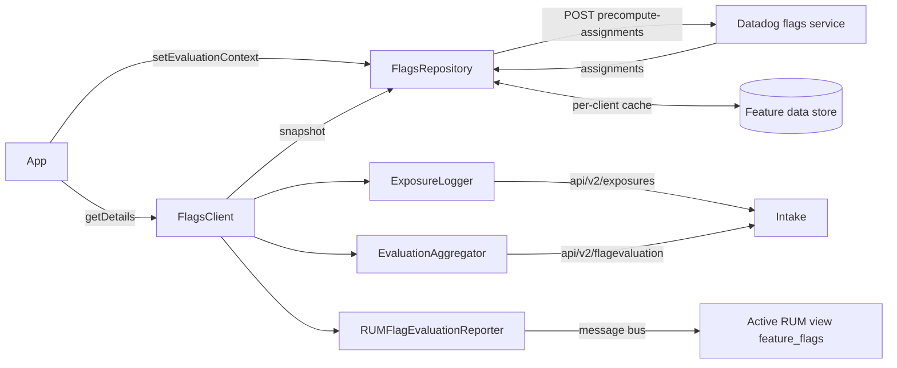

# Flags Feature

## Overview

Flags evaluates Datadog feature flags in the app. A `FlagsClient` sends the evaluation context (targeting key and attributes) to the Datadog flags service, which returns **precomputed assignments** for every flag. All evaluations are then local and synchronous. The client caches assignments on disk per client name, logs exposures for experiments, aggregates evaluation counts, and annotates the active RUM view with the variant served.

Call `Datadog.initialize()` before `Flags.enable()`, and `Flags.enable()` before `FlagsClient.create()`. RUM is optional: without it, the RUM integration is a no-op.

**Platform**: iOS, tvOS, watchOS, visionOS. Flags has no Objective-C API.

## Quick Start Example

```swift
import Foundation
import DatadogCore
import DatadogFlags

Datadog.initialize(
    with: Datadog.Configuration(clientToken: "<client_token>", env: "<environment>"),
    trackingConsent: .granted
)

// Enable the feature once, before creating any client.
Flags.enable(
    with: Flags.Configuration(
        // `true` (default): API misuse logs a console warning in Debug builds; `false` crashes with `fatalError` in Debug builds.
        // Release builds always log the issue via the SDK logger.
        gracefulModeEnabled: true,
        // Custom URL for fetching assignments, e.g. a proxy. Default: nil (Datadog endpoint for the configured site).
        customFlagsEndpoint: URL(string: "https://flags-proxy.example.com/precompute-assignments"),
        // Extra headers for requests to `customFlagsEndpoint`; ignored on the Datadog endpoint. Default: nil.
        customFlagsHeaders: ["Authorization": "Bearer <token>"],
        // Max seconds the first `setEvaluationContext` waits before failing with `.initializationTimedOut`. Default: 5.
        // nil, zero, negative or non-finite disables it.
        initializationTimeout: 5,
        // Custom URL for exposure events. Default: nil (`<site intake>/api/v2/exposures`).
        customExposureEndpoint: nil,
        // Log exposures for allocations that request it. Default: true.
        trackExposures: true,
        // Custom URL for aggregated evaluation events. Default: nil (`<site intake>/api/v2/flagevaluation`).
        customEvaluationEndpoint: nil,
        // Aggregate and send flag evaluation counts. Default: true.
        trackEvaluations: true,
        // Seconds between evaluation flushes, clamped to 1...60. Default: 10.
        evaluationFlushInterval: 10.0,
        // Add evaluated flags to the active RUM view. Default: true.
        rumIntegrationEnabled: true,
        // Load only flags matching these tags or whole-key patterns (`*` wildcard). Default: nil (all flags).
        flagSelection: Flags.FlagSelection(tags: ["checkout"], keyPatterns: ["checkout-*"])
    )
)

// Create a client. Clients are retained by name; no need to keep a reference.
let client = FlagsClient.create(
    configuration: FlagsClient.Configuration(
        // Honor the `dd_evaluation_telemetry_opt_out` context attribute. Default: false.
        enableEvaluationTelemetryOptOutParameter: false,
        // How to apply the `dd_experimentation_opt_out_at` context attribute. Default: .disabled.
        experimentationOptOutMode: .disabled
    ),
    name: FlagsClient.defaultName // "default"
)

// Set the context. Assignments are fetched for this subject.
client.setEvaluationContext(
    FlagsEvaluationContext(
        targetingKey: "user-123",
        attributes: ["plan": .string("premium"), "beta_tester": .bool(true)]
    )
) { result in
    // .success once assignments are ready; .failure(FlagsError) otherwise.
}

// Evaluate anywhere, synchronously. A failed evaluation returns `defaultValue`.
let enabled = FlagsClient.shared().getBooleanValue(key: "new-checkout", defaultValue: false)
let details = client.getStringDetails(key: "button-text", defaultValue: "Buy")
// details.value, details.variant, details.reason, details.allocationKey, details.error
```

### Evaluation API

All methods are on `FlagsClientProtocol`:

| Method | Returns |
|---|---|
| `getBooleanValue` / `getStringValue` / `getIntegerValue` / `getDoubleValue` / `getObjectValue` | The value, or `defaultValue` on any error |
| `getBooleanDetails` / `getStringDetails` / `getIntegerDetails` / `getDoubleDetails` / `getObjectDetails` | `FlagDetails<T>` with value, variant, reason, allocation key, error |
| `getValue(key:defaultValue:)` / `getDetails(key:defaultValue:)` | Generic over `FlagValue` (`Bool`, `String`, `Int`, `Double`, `AnyValue`) |
| `setEvaluationContext(_:)` / `setEvaluationContext(_:completion:)` / `try await setEvaluationContext(_:)` | Fire-and-forget, callback, or async throwing |
| `state` | `FlagsStateObservable`: `currentState`, `addListener(_:)`, `removeListener(_:)` |
| `onFirstFlags(_:)` | One-shot listener for the first accepted configuration; returns a `FlagsSubscription` to `cancel()` |
| `snapshot()` | **Preview API**: side-effect-free `FlagsSnapshot` of cached assignments; records no exposure, evaluation or RUM annotation. Returns `nil` when no assignments are readable (no context or cache, `.error` state, fallback client) or when assignments use obfuscated flag keys |

Object flags use `AnyValue` (`.string`, `.bool`, `.int`, `.double`, `.dictionary`, `.array`, `.null`). Context attributes use the same type.

## Architecture Overview



- `Flags.enable()` registers `FlagsFeature` and, when `trackEvaluations` is `true`, a separate `FlagsEvaluationFeature` for evaluation uploads. Both run on the main thread synchronously.
- `setEvaluationContext` sends one request with the targeting key, attributes, `env`, SDK version, the optional flag selection, and the opt-out policy. When RUM is enabled, the RUM application ID is sent as the `dd-application-id` header.
- `getDetails` reads the in-memory assignment for the key. Until the initial disk cache read finishes, each call waits up to 100 ms for it.

## Key Files

### Feature Entry Point
- `DatadogFlags/Sources/Flags.swift` — `Flags.enable()`, `Flags.Configuration`, `Flags.FlagSelection`.

### Public API
- `DatadogFlags/Sources/Client/FlagsClient.swift` — `create`, `shared`, `FlagsClient.Configuration`, `ExperimentationOptOutMode`, `getDetails` (evaluation, exposure, telemetry and RUM reporting).
- `DatadogFlags/Sources/Client/FlagsClientProtocol.swift` — Protocol plus typed convenience getters, async `setEvaluationContext`, `snapshot()`.
- `DatadogFlags/Sources/Client/FlagsClientState.swift` — `FlagsClientState`.
- `DatadogFlags/Sources/Client/FlagsStateManager.swift` — `FlagsStateObservable`, `FlagsStateListener`.
- `DatadogFlags/Sources/Models/FlagsEvaluationContext.swift` — Context type and opt-out timestamp parsing.
- `DatadogFlags/Sources/Models/FlagDetails.swift` — `FlagDetails`, `FlagEvaluationError`, `FlagsSnapshot`, `FlagSnapshot`.
- `DatadogFlags/Sources/Models/FlagsError.swift` — Errors returned by `setEvaluationContext`.
- `DatadogFlags/Sources/Models/FlagsClientEvent.swift` — `onFirstFlags` event, listener and subscription types.
- `DatadogFlags/Sources/Models/FlagValue.swift`, `DatadogFlags/Sources/Models/AnyValue.swift` — Supported value types.
- `DatadogFlags/Sources/Client/FlagsClientInternal.swift` — `@_spi(Internal)` methods for cross-platform bridges.
- `DatadogFlags/Sources/Models/FlagAssignment.swift` — `FlagAssignment`, the assignment type exposed by the bridge methods.

### Implementation
- `DatadogFlags/Sources/Client/FlagsRepository.swift` — Context requests, cache restore, state transitions, initialization timeout.
- `DatadogFlags/Sources/Client/FlagAssignmentsFetcher.swift` — Endpoint per site, response handling, flag selection fallbacks.
- `DatadogFlags/Sources/Client/FlagAssignmentsRequest.swift` — Request headers and body.
- `DatadogFlags/Sources/Client/FlagsDataStore.swift` — Per-client disk cache and its versions.
- `DatadogFlags/Sources/Client/FallbackFlagsClient.swift` — No-op client returned on misuse.
- `DatadogFlags/Sources/Client/ExposureLogger.swift`, `DatadogFlags/Sources/Client/ExposureTracker.swift` — Exposure events and deduplication.
- `DatadogFlags/Sources/Client/EvaluationAggregator.swift` — Evaluation counts and flush timer.
- `DatadogFlags/Sources/Client/RUMFlagEvaluationReporter.swift` — Message to RUM.
- `DatadogFlags/Sources/Feature/FlagsFeature.swift` — Feature wiring and flush interval clamping.
- `DatadogFlags/Sources/Feature/IssueReporter.swift` — Graceful mode behavior.
- `DatadogRUM/Sources/Integrations/FlagEvaluationReceiver.swift` — RUM side of the integration.
- `DatadogFlags/README.md` — Detailed rules for the evaluation telemetry opt-out and experimentation opt-out.

## Configuration Categories

### Endpoints
- Assignments are fetched from `https://preview.ff-cdn.<site domain>/precompute-assignments` (for example `preview.ff-cdn.datadoghq.eu` for EU1). Government sites (`us1_fed`, `us2_fed`) are not supported: the SDK logs a warning and uses the US1 endpoint.
- `customFlagsEndpoint` replaces the full assignments URL.
- `customFlagsHeaders` are sent only with requests to `customFlagsEndpoint`. They are ignored when using the default Datadog endpoint, so proxy credentials never reach the Datadog CDN.
- `customExposureEndpoint` and `customEvaluationEndpoint` replace the intake URLs for exposures and evaluations.

### Startup and Caching
- Assignments are saved per client name after each successful fetch. On the next launch, the cached assignments load at client creation and can be evaluated **before** `setEvaluationContext` is called. Their `reason` is `"CACHED"`. With an experimentation opt-out mode enabled, cached assignments are served only after `setEvaluationContext` with the same context.
- After `setEvaluationContext`, cached assignments are used only if they were fetched for an identical context (same targeting key and attributes). Otherwise evaluations return defaults until the fetch completes.
- When a later context replaces a context that already has fresh assignments, the previous assignments stay readable while the new fetch is in flight (state `.reconciling`), unless an experimentation opt-out mode is enabled.
- `initializationTimeout` applies only to the first `setEvaluationContext` call. On timeout, the completion receives `.initializationTimedOut` and the state becomes `.stale` (cache for that context) or `.error`. The request continues and can still move the client to `.ready`.

### Client State

| State | Meaning |
|---|---|
| `.notReady` | No context set yet |
| `.reconciling` | Fetch in progress; previous assignments may still be served |
| `.ready` | Assignments for the latest context are loaded |
| `.stale` | Fetch failed, cached assignments for the same context are served |
| `.error` | Context invalid (even with a matching cache), or fetch failed with no matching cache: every evaluation returns the default with `.invalidContext` or `.providerNotReady` respectively |

Listeners are held weakly and called with the current state when added. A state can be skipped if a newer one supersedes it.

### Flag Selection
- `Flags.FlagSelection` applies to every client and is fixed at `Flags.enable()`.
- A flag is loaded if it has any listed tag (exact, case-sensitive) or its whole key matches any pattern (`*` matches any run of characters).
- Values are trimmed and deduplicated. Each list accepts at most 31 values, each value at most 200 UTF-8 bytes. Over a limit, the selection is not sent: the SDK logs an error and loads every flag.
- If the server ignores the selection, it loads every flag and the SDK logs the reason (from the `DD-Flag-Selection-Ignored` header). A proxy behind `customFlagsEndpoint` must forward that header.
- A cache saved under a different selection is not loaded.

### Exposures and Evaluation Telemetry
- **Exposures** are written only for allocations whose assignment has `doLog` set (experiments). They are deduplicated in memory per client by targeting key and flag key, and logged again when the allocation, variant or serial ID changes. They include the targeting key and all context attributes.
- **Evaluations** are aggregated and flushed every `evaluationFlushInterval` seconds, or when 1,000 aggregations accumulate. Failed evaluations are also counted, with an error code.
- Both are written through the SDK's storage, so they follow tracking consent like other events.
- With `enableEvaluationTelemetryOptOutParameter`, a context attribute `dd_evaluation_telemetry_opt_out: .bool(true)` suppresses evaluation events and RUM annotations for that subject, but not exposures. See `DatadogFlags/README.md`.

### Experimentation Opt-Out
- `experimentationOptOutMode` reads the context attribute `dd_experimentation_opt_out_at`, an RFC3339 timestamp string. `.immediate` excludes the subject from all experiment allocations; `.futureExperimentsOnly` excludes experiments activated at or after the timestamp.
- A malformed value fails `setEvaluationContext` with `.invalidContext` without a request, and evaluations return `.invalidContext`.
- The service must acknowledge the policy, or the response is rejected with `.invalidResponse`. Full rules in `DatadogFlags/README.md`.

### Graceful Mode
`gracefulModeEnabled` controls what happens on API misuse: creating a client before `Flags.enable()`, creating an existing client name, or calling `shared(named:)` for a name never created. Misuse returns the existing client or a no-op `FallbackFlagsClient`.
- Debug build of the SDK, `true`: console message `🔥 Datadog SDK usage error: ...`.
- Debug build of the SDK, `false`: `fatalError`. Misuse before `Flags.enable()` always behaves as `true`, because the configuration isn't known yet.
- Release build of the SDK: `DD.logger.error`, visible only with `Datadog.verbosityLevel` set.

"Debug build" refers to how the SDK module itself was compiled (`DEBUG` flag), not the app.

## Common Troubleshooting Patterns

### "Every flag returns its default value"
**Causes:** Check `details.error` and `client.state.currentState` to find which of these applies:
- `.providerNotReady`: no context set yet and no cache, the fetch is still running, or the client is in `.error`.
- `.flagNotFound`: the key is not in the assignments. The flag is missing in this environment, not targeted at this subject, excluded by `flagSelection`, or the key is misspelled.
- `.typeMismatch`: the getter type differs from the flag's type, for example `getIntegerValue` on a flag served as a double. `getDoubleValue` accepts whole numbers from a "number" flag, but not from an "integer" flag.
- `.invalidContext`: `dd_experimentation_opt_out_at` is malformed while an opt-out mode is enabled.
- The client came from `FlagsClient.shared(named:)` before it was created, or `create` ran before `Flags.enable()`: this returns a no-op client that always returns defaults with `.providerNotReady`. Look for the SDK usage error message.

**Solutions:** Call `Flags.enable()`, then `FlagsClient.create()`, then `setEvaluationContext` and wait for its completion (or `.ready` state) before relying on values.

### "Flags are fetched but the evaluation is for the wrong environment or site"
**Causes:** Assignments depend on `env` from `Datadog.Configuration` and the site's endpoint. A wrong `env` or `site` returns another environment's assignments or none.

**Solutions:** Check `env` and `site` in `Datadog.Configuration` match the environment where the flag is configured.

### "New client configuration is ignored"
**Causes:** A client with that name already exists. `create` returns the existing client and keeps its original configuration. `Flags.Configuration` is also fixed after `Flags.enable()`.

**Solutions:** Use a new client name, or set the configuration on the first `create` call.

### "Values from the previous user are served after switching users"
**Causes:** While the new context's fetch is running (`.reconciling`), the previous context's assignments stay readable when no experimentation opt-out mode is set.

**Solutions:** Wait for the `setEvaluationContext` completion (or `.ready`) before evaluating flags that must match the new user.

### "RUM shows the variant key, not the flag value"
**Expected.** The RUM integration records the **variant key** under the view's `feature_flags.<flag key>`, not the evaluated value. It is attached only to the view active at evaluation time; evaluations without an active RUM view are dropped from RUM. RUM errors on that view carry the same feature flags.

### "No exposures in Datadog"
**Causes:**
- `trackExposures` is `false`.
- The allocation is not an experiment (no `doLog`). Plain rollouts log no exposures.
- The same subject already saw that variant in this process (deduplication).
- Tracking consent is not `.granted`.

**Solutions:** Confirm `trackExposures`, that the flag runs an experiment allocation, and the tracking consent value.

### "No RUM annotations or evaluation data for some users"
**Causes:** `enableEvaluationTelemetryOptOutParameter` is `true` and the context has `dd_evaluation_telemetry_opt_out: .bool(true)`. Until the cached policy loads at startup, evaluation telemetry is also suppressed.

**Solutions:** Check the context attributes for those users. This is expected behavior when the opt-out is set.

### "`setEvaluationContext` fails with `.initializationTimedOut`"
**Causes:** The first fetch took longer than `initializationTimeout` (default 5 s), often on a slow network. The fetch keeps running and the client may become `.ready` later.

**Solutions:** Treat it as "not ready yet": observe `state` or `onFirstFlags`. Raise the timeout, or pass `nil` to disable it.

## Feature Interactions

- **RUM**: optional. With `rumIntegrationEnabled`, each successful evaluation adds `feature_flags.<key> = <variant key>` to the active view. RUM must be enabled for this; without it, messages are ignored. When RUM is enabled before the fetch, the request also carries the RUM application ID.
- **Tracking consent**: exposures and evaluation events are stored and uploaded like other events, following the SDK's tracking consent. Assignment fetching does not depend on consent.
- **Cross-platform SDKs**: React Native and other bridges use `@_spi(Internal)` methods (`getFlagAssignments`, `sendFlagEvaluation`, `sendFlagExposure`, `sendFlagEvaluationEvent`, `sendFlagRUMEvaluation`). Obfuscated flag keys are supported only when the SDK source is `ios`.
- **OpenFeature**: `dd-openfeature-provider-swift` wraps `FlagsClient` and reads `state` to map provider status.

## Additional Context

- `FlagsClient.Configuration` has a second initializer, `init(enableEvaluationTelemetryOptOutParameter:)`, kept for binary compatibility. `Flags.Configuration` also keeps an initializer without `flagSelection`.
- `FlagsSnapshot`, `FlagSnapshot` and `snapshot()` are marked as preview and may change.
- `FlagsClientState` documentation mentions `reset()`, but reset is internal and not available to apps.
- `onFirstFlags` listeners run on a background queue, or on the calling thread if the first configuration was already published. `flagsChanged` lists configuration keys, which may be obfuscated rather than plaintext names. The no-op fallback client calls the listener immediately with an empty list.
- Exposure deduplication is in memory, per client, for up to 5,000 subject and flag pairs, so a new process logs exposures again.
- Disk caches filtered by flag selection or an opt-out policy use cache version 3, which SDK versions without these features skip.
