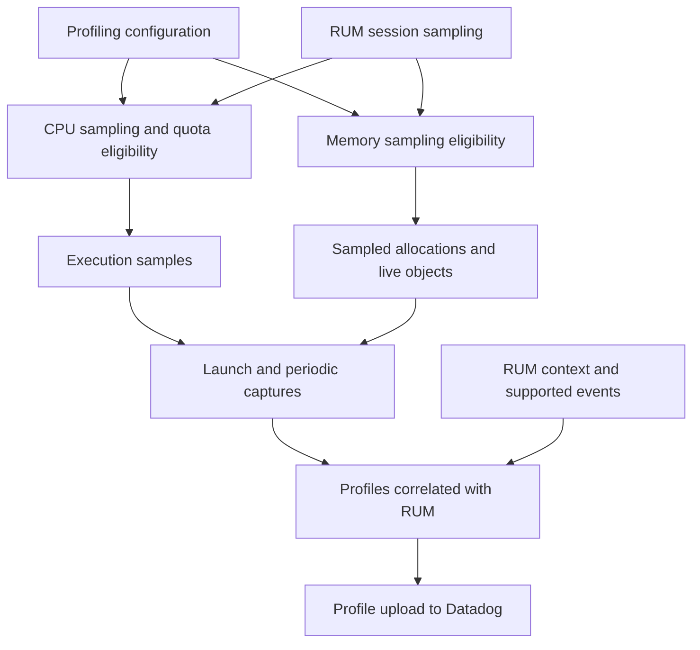

# Profiling Feature

## Overview

Profiling helps explain slow execution and memory growth in RUM sessions. CPU profiles show where application threads spend wall time and CPU time. Optional memory profiles estimate allocation activity and the class instances still alive at capture time.

- **Application launch profiling** captures startup through time to initial display (TTID).
- **Continuous CPU profiling** collects execution samples during selected RUM sessions.
- **Memory profiling** collects heap snapshots during separately selected RUM sessions. It is disabled by default and can run without CPU profiling.

Initialize Datadog, enable RUM, and then enable Profiling. Profiles require a sampled-in RUM session and correlated RUM events; enabling Profiling alone does not guarantee an upload. Profiling supports one SDK instance per process. Later enable calls keep the existing instance active and log an error.

**Platform**: iOS 15.0+, tvOS 15.0+, visionOS 1.0+. Profiling has no API on watchOS or macOS. The feature entry point and configuration are Swift APIs.

## Quick Start Example

This example opts into memory profiling for 5% of RUM sessions. Outside SDK debug mode, omit `memorySampleRate`, or set it to `0`, to leave memory profiling disabled. Review [Memory Profiling](#memory-profiling) before opting in.

```swift
import DatadogCore
import DatadogRUM
import DatadogProfiling

// 1. Initialize the Core SDK before enabling RUM or Profiling.
Datadog.initialize(
    with: Datadog.Configuration(
        clientToken: "<client_token>",
        env: "<environment>"
    ),
    trackingConsent: .granted
)

// 2. Enable RUM to provide the session, view, and event correlations for profiles.
RUM.enable(
    with: RUM.Configuration(
        applicationID: "<rum_application_id>",
        uiKitViewsPredicate: DefaultUIKitRUMViewsPredicate(),
        uiKitActionsPredicate: DefaultUIKitRUMActionsPredicate(),

        // Profiles can include long tasks and app hangs when their RUM tracking is enabled.
        // Long task threshold in seconds. Default: 0.1.
        longTaskThreshold: 0.1,
        // App hang threshold in seconds. Default: nil (disabled).
        appHangThreshold: 2.0
    )
)

// 3. Enable Profiling. SDK debug mode overrides all three sample rates to 100%.
Profiling.enable(
    with: Profiling.Configuration(
        // Optional custom URL for profile uploads.
        // Default: nil, using the configured Datadog site.
        customEndpoint: nil,

        // CPU application launch profiling sample rate.
        // 100 = all launches eligible, 0 = launch profiling disabled.
        // Applies to the next process launch and also requires a sampled-in RUM session.
        // Default: 5.0.
        applicationLaunchSampleRate: 5.0,

        // Continuous CPU profiling sample rate, applied in addition to RUM session sampling.
        // 100 = all sampled-in RUM sessions eligible, 0 = continuous CPU profiling disabled.
        // Default: 5.0.
        continuousSampleRate: 5.0,

        // Memory profiling sample rate, applied in addition to RUM session sampling.
        // 100 = all sampled-in RUM sessions eligible, 0 = memory profiling disabled.
        // Independent of the CPU rate; opting in enables runtime interception.
        // Default: 0.0 (disabled). This example explicitly opts in at 5%.
        memorySampleRate: 5.0
    )
)
```

Enable RUM early in application startup so launch profiling can correlate with TTID. Profiling launch settings take effect on the next process launch, so the first run after enabling the feature may not include startup samples.

## Architecture Overview

CPU and memory collection use separate sampling decisions and produce complementary data. CPU profiles describe execution over a time interval; heap profiles describe allocation activity over a window and live objects at its end. A heap snapshot cannot be sliced to the duration of a view or operation.

During eligible sessions, the SDK coordinates periodic CPU and heap captures on an approximately 60-second cadence. Launch captures and transitions such as entering the background can close shorter windows. CPU and heap data use the same upload path and can be sent together when both are available. Either can also be uploaded alone.



A capture is uploaded only when it has correlated RUM events. A quiet window may therefore produce no upload even when collection is active. Application state, tracking consent, and resource conditions also determine whether data can be collected or uploaded.

## Key Files

These public API references define the available configuration and integration points:

- **`DatadogProfiling/Sources/Profiling.swift`** — `Profiling.enable(with:in:)` enables the feature on the default or a supplied SDK instance.
- **`DatadogProfiling/Sources/ProfilingConfiguration.swift`** — upload endpoint and sampling rates.
- **`DatadogInternal/Sources/Models/Profiling/ProfilingOptions.swift`** — sampling options passed to RUM operations.

## Configuration Categories

### Sampling

All sampling rates accept values from `0.0` to `100.0`. Outside SDK debug mode, zero disables that profiling mode. CPU and memory session decisions use the RUM session sample rate in addition to their own configured rates.

| Setting | Default | Effect |
| --- | --- | --- |
| `applicationLaunchSampleRate` | `5.0` | Selects application launches for CPU startup profiling. Takes effect on the next process launch; the launch profile also requires an eligible RUM session. |
| `continuousSampleRate` | `5.0` | Selects RUM sessions for continuous CPU profiling. |
| `memorySampleRate` | `0.0` | Selects RUM sessions for continuous memory profiling. Also controls early memory collection on the next process launch. |

For example, a RUM session rate of 80% and a memory rate of 5% select approximately 4% of all sessions for memory profiling. CPU and memory have separate rates: a session can collect memory profiles while CPU profiling is sampled out, or the reverse.

SDK debug mode raises all three profiling rates to 100%, including memory profiling.

### Upload Endpoint

`customEndpoint` defaults to `nil`, which sends profiles to the Datadog site selected in `Datadog.Configuration`. Set it only when profiles should use a custom upload URL.

### Tracking Consent and Runtime Conditions

With `.pending` consent, profiles can be collected and stored locally while upload waits for consent. Granting consent permits upload; setting consent to `.notGranted` stops collection and discards pending data.

CPU collection and memory profile emission pause while the app is in the background, Low Power Mode is enabled, or the battery is below 10% and not charging. Eligible foreground data can be captured when the app backgrounds.

Memory allocation and free tracking continue while emission is paused, preserving live-object information. Background allocations can therefore appear in a later foreground heap window. Collection stops when the session is sampled out or consent is revoked.

### CPU Profiling Quota

CPU profiling also depends on session quota admission. Explicit quota rejection stops CPU profiling for that session; a new session receives a new decision. Temporary quota lookup failures do not block CPU profiling. Memory profiling is independent of this CPU quota.

## RUM Correlation

| RUM event | CPU profiles | Heap profiles |
| --- | --- | --- |
| Time to initial display (TTID) | Correlates application startup. | Correlates a launch heap snapshot when early memory collection was sampled in. |
| Time to full display (TTFD) | Can be attached to a continuous CPU profile. | Does not independently trigger or correlate a heap snapshot. |
| Sampled operation steps | Can be attached to an active CPU profile. | Do not independently trigger or correlate a heap snapshot. |
| App hangs and long tasks | Can be attached when they overlap collected CPU samples. | Can be attached when they overlap the heap collection window. |

App hangs and long tasks are included in captured windows; receiving one does not immediately trigger a separate profile. RUM memory warnings do not currently trigger a heap snapshot either. When CPU and heap data are uploaded together, they share the upload's RUM correlations.

To report TTFD or correlate an operation with CPU profiling:

```swift
let monitor = RUMMonitor.shared()

// Optional: Report TTFD when the launch content is fully displayed.
// Continuous CPU profiles can correlate with this full-display timing; this does not report TTID.
monitor.reportAppFullyDisplayed()

// Optional: Correlate a RUM operation with an active CPU profile.
// Sampled operation steps do not start a stopped profiler or request a heap snapshot.
monitor.startOperation(
    name: "checkout_flow",
    operationKey: "cart-123",
    attributes: ["screen": "checkout"],
    // Applied in addition to RUM session sampling; 100 selects every eligible operation.
    options: ProfilingOptions(sampleRate: 100.0)
)

// Perform the work being measured.

// Complete the operation using the same name and operation key.
monitor.succeedOperation(
    name: "checkout_flow",
    operationKey: "cart-123",
    attributes: ["result": "success"]
)
```

`ProfilingOptions(sampleRate:)` is composed with RUM session sampling. It selects operation correlation; it does not enable continuous CPU profiling or start a stopped profiler. Operation APIs are in preview.

## Exploring Profiles

Open a profile from its correlated RUM event to investigate execution during a slow launch, app hang, long task, or operation. CPU profiles show execution over time; heap profiles show which supported classes and allocation stacks account for allocation activity or retained objects. See [Correlate RUM and Profiling](https://docs.datadoghq.com/real_user_monitoring/correlate_with_other_telemetry/profiling/) for the profile exploration workflow.

Readable application stack frames require symbols matching the profiled build. Upload the app's matching dSYM files to Datadog; missing symbols can leave application frames as addresses. See the [iOS dSYM upload instructions](https://docs.datadoghq.com/real_user_monitoring/application_monitoring/ios/error_tracking/#upload-your-dsym-files).

## Memory Profiling

### Opt-In and Coverage

Memory profiling observes supported Objective-C and Swift class allocations and deallocations. Opting in enables runtime interception, which can interact with other instrumentation, similar to RUM automatic instrumentation. If memory profiling cannot initialize or capture successfully, it stops without disabling RUM or CPU profiling.

Heap profiles contain sampled estimates grouped by allocation stack and class. They cover class-instance storage, rather than every allocation made by the process. Swift value-type backing buffers such as `Array`, `Dictionary`, `String`, and `Data`, raw C/C++ allocations, and large virtual-memory buffers are outside this coverage. Class names are best effort and may include private Foundation class-cluster names.

### Reading Heap Values

| Value | Meaning |
| --- | --- |
| `alloc_objects` | Estimated number of supported objects allocated during the collection window. |
| `alloc_space` | Estimated instance bytes allocated during the collection window. |
| `inuse_objects` | Estimated number of supported objects still alive at capture time. |
| `inuse_space` | Estimated instance bytes still alive at capture time; the default heap sample type. |

Use `alloc_*` to investigate allocation churn and `inuse_*` to investigate retained growth. Counts and bytes are scaled estimates, so a profile is not an exact object census. Small populations may not be sampled, and bounded collection can drop samples under heavy load.

Heap totals do not represent the app's total memory footprint and should not be expected to match the RUM memory usage curve. Instance bytes exclude backing storage and other memory reachable from an object.

### Launch and Session Boundaries

Early launch collection uses the previous process's memory configuration. It still requires RUM sampling and foreground eligibility before a launch heap profile can be emitted. TTFD does not replace TTID for this launch capture.

At a RUM session boundary, memory allocation activity is closed for the ending session. Live objects remain visible across consecutive sessions that both collect memory profiles. If the next session is sampled out, collection stops and the live set is cleared; a later sampled-in session starts fresh.

## Remote Configuration

When `Datadog.Configuration.remoteConfiguration` is configured, a cached or already-fetched remote document can override `applicationLaunchSampleRate` and `continuousSampleRate` at `Profiling.enable(with:)` time. Omitted values preserve the in-code settings.

The merge happens once when Profiling is enabled. Later remote refreshes do not change an already-running feature. `memorySampleRate` currently uses only the in-code value and cannot be remotely changed or disabled.

## Common Troubleshooting Patterns

### No Profiles Appear

1. Initialize Datadog, enable RUM, and then enable Profiling on the intended SDK instance.
2. Check that the relevant rate is above zero and that RUM session sampling admits the session.
3. Grant tracking consent for uploads, and check foreground, battery, and Low Power Mode conditions.
4. Ensure the window includes supported RUM correlations. A periodic capture alone does not guarantee an upload.
5. For CPU profiles, check whether the session was rejected by quota. Memory profiling is independent of that decision.

### CPU Profiles Appear but Heap Profiles Are Missing

Set `memorySampleRate` above zero for normal use; SDK debug mode overrides it to 100%. For heap-only uploads after launch, enable RUM long task or app hang tracking. TTFD and operation steps alone do not provide independent heap correlations. A window without observed allocations or live-set changes may also produce no heap data.

### Application Launch Profiles Are Missing

Launch configuration applies to the next process launch. Enable RUM early enough to report TTID, and confirm the launch and RUM session were both admitted. Calling `reportAppFullyDisplayed()` reports TTFD and does not replace TTID. System prewarming can prevent an ordinary launch profile.

### Profiles Stop When the App Backgrounds

CPU collection and heap emission pause in the background. Memory allocation/free tracking continues for eligible sessions so live-object information survives until foreground emission resumes.

## Feature Interactions

- **RUM** supplies session sampling, application/session/view context, and the supported event correlations. Enable long task or app hang tracking when those correlations are needed.
- **Tracking consent** controls local storage and upload, as well as stopping collection when consent is not granted.
- **Remote Configuration** can override the two CPU rates when Profiling is enabled; memory sampling remains configured in code.

## Additional Context

- CPU profiles contain wall-time and CPU-time values. Heap profiles contain the four allocation/live-object values above. They are complementary views of application behavior.
- Profiling produces pprof data. CPU and heap data can share an upload, and a heap profile does not require a CPU attachment.
- CPU profiling stops for the remainder of the process after a profiler memory-allocation failure. Memory initialization or capture failures disable that memory profiler for the remainder of its lifetime.
- There is no public API to request an immediate heap snapshot or independently start/stop a profiling mode after enabling the feature.
