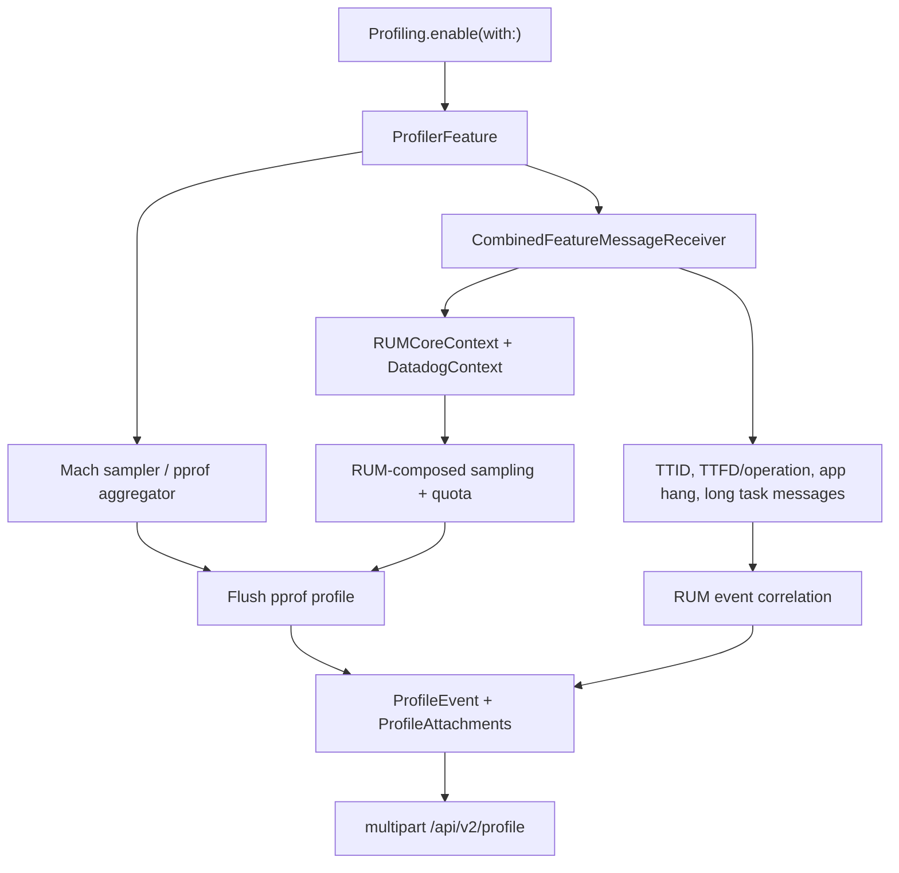

# Profiling Feature

## Overview

Profiling captures pprof wall-time, CPU-time, and sampled heap allocations from Apple application processes and correlates them with RUM context. It supports three profiling paths:

- **Application launch profiling**: captures process startup and writes the launch profile when RUM emits the TTID app-launch vital.
- **Continuous Profiling**: periodically records profiles for sampled-in RUM sessions and links long tasks and app hangs.
- **Memory profiling**: records sampled allocations for eligible RUM sessions and emits periodic heap profiles or snapshots triggered by TTID, app hangs, and memory warnings.

Profiling requires `Datadog.initialize()` before `Profiling.enable()`. RUM is not a compile-time module dependency, but the feature depends on RUM context and RUM payload messages for session-linked sampling, quota checks, and profile correlation.

**Platform**: iOS, tvOS, visionOS. The Swift sources and Mach profiler are compiled out on watchOS with `#if !os(watchOS)`.

**API status**: `Profiling.enable(with:in:)` is experimental.

## Quick Start Example

```swift
import Foundation
import DatadogCore
import DatadogRUM
import DatadogProfiling

// 1. Initialize Core SDK first
Datadog.initialize(
    with: Datadog.Configuration(
        clientToken: "<client_token>",
        env: "<environment>"
    ),
    trackingConsent: .granted
)

// 2. Enable RUM so Profiling can receive session context and operation/vital messages
RUM.enable(
    with: RUM.Configuration(
        applicationID: "<rum_application_id>",
        uiKitViewsPredicate: DefaultUIKitRUMViewsPredicate(),
        uiKitActionsPredicate: DefaultUIKitRUMActionsPredicate(),

        // Continuous Profiling can attach app hangs and long tasks to profiles
        // when these RUM performance features are enabled.
        // longTaskThreshold default: 0.1 seconds
        longTaskThreshold: 0.1,
        // appHangThreshold default: nil (disabled)
        appHangThreshold: 2.0
    )
)

// 3. Enable Profiling
Profiling.enable(
    with: Profiling.Configuration(
        // Custom intake endpoint for profile uploads.
        // Default: nil (uses Datadog intake at /api/v2/profile)
        customEndpoint: nil,

        // Application launch profiling sample rate.
        // 100 = all launches profiled, 0 = none profiled.
        // Applies to the next process launch.
        // Default: 5.0
        applicationLaunchSampleRate: 5.0,

        // Continuous Profiling sample rate, composed with the RUM session sampler.
        // 100 = all sampled-in RUM sessions eligible, 0 = continuous profiling disabled.
        // Default: 5.0
        continuousSampleRate: 5.0,

        // Memory profiling sample rate, composed with the RUM session sampler.
        // 0 disables heap collection; values above 0 opt in.
        // Default: 0.0
        memorySampleRate: 0.0
    )
)

let monitor = RUMMonitor.shared()

// 4. (Optional) Report TTFD so continuous profiles can correlate with full-display timing
monitor.reportAppFullyDisplayed()

// 5. (Optional) Correlate a RUM operation with the continuous profile.
// Sampled operation steps are attached only while Continuous Profiling is running;
// they do not start a standalone profile on their own.
monitor.startOperation(
    name: "checkout_flow",
    operationKey: "cart-123",
    attributes: ["screen": "checkout"],
    options: ProfilingOptions(sampleRate: 100.0)
)

// Work being profiled...

monitor.succeedOperation(
    name: "checkout_flow",
    operationKey: "cart-123",
    attributes: ["result": "success"]
)
```

## Architecture Overview

Profiling is a `DatadogRemoteFeature` named `profiler`. `Profiling.enable(with:in:)` registers `ProfilerFeature`, which builds a request builder, session sampler provider, quota checker, and a single `DatadogProfiler` message receiver.

The low-level sampler lives in `DatadogProfiling/Mach`. It samples application thread stacks and CPU time with Mach APIs, aggregates them into a pprof profile, and exposes the native profiler to Swift through a C interface.

`ProfilerFeature` writes UserDefaults keys consumed by the native auto-start path for app-launch profiling. The Swift side then decides when to keep the native profiler running, when to flush profiles, and whether to write or drop a profile.



`ProfilingContext` is published into core context so RUM events can include whether profiling is running, stopped, or in an error state.

## Key Files

### Feature Entry Point
- **`DatadogProfiling/Sources/Profiling.swift`** - Main entry point. Call `Profiling.enable(with:in:)` to register the feature with core.

### Configuration
- **`DatadogProfiling/Sources/ProfilingConfiguration.swift`** - Customer-facing configuration: `customEndpoint`, `applicationLaunchSampleRate`, `continuousSampleRate`, and `memorySampleRate`. Also defines `apply(remoteConfiguration:)` (see [Remote Configuration](#remote-configuration)).

### Runtime Orchestration
- **`DatadogProfiling/Sources/ProfilerFeature.swift`** - Internal feature composition. Registers message receivers, configures app-launch UserDefaults, creates samplers and quota checks.
- **`DatadogProfiling/Sources/DatadogProfiler.swift`** - App-launch, Continuous, and Custom Profiling state machine. Owns the native profiler lifecycle, handles RUM messages, and flushes profiles.
- **`DatadogProfiling/Sources/ProfilingSamplerProvider.swift`** - Stores continuous profiling configuration and session-linked sampling decisions.
- **`DatadogProfiling/Sources/ProfilingQuotaChecker.swift`** - Checks session-scoped profiling quota admission.
- **`DatadogProfiling/Sources/Models/ProfilingConditions.swift`** - Blocks CPU profiling, and memory profile *uploads*, in low battery, Low Power Mode, or background conditions. Memory *recording* is not blocked — see Runtime Conditions.

### Event Writing and Upload
- **`DatadogProfiling/Sources/ProfilingHandler.swift`** - Shared write path for app-launch and continuous profiles. Serializes pprof data and RUM events into a profile event.
- **`DatadogProfiling/Sources/RequestBuilder.swift`** - Builds the multipart upload to `/api/v2/profile`.
- **`DatadogProfiling/Sources/ProfileEvent.swift`** - JSON event metadata for a profile.
- **`DatadogProfiling/Sources/Models/ProfileAttachments.swift`** - pprof and RUM event attachments.

### Native Profiler
- **`DatadogProfiling/Mach/`** - Native Mach sampler and pprof aggregation layer exposed to Swift through `dd_profiler.h` and `dd_pprof.h`.
- **`DatadogProfiling/Mach/memory_profiler.cpp`** - Owns allocation-hook observers, one Poisson sampler per thread, and the bounded allocation window. Event captures snapshot live objects without draining periodic allocation totals; Swift type names resolve during heap encoding.
- **`DatadogProfiling/Sources/Memory/MemoryProfiler.swift`** - Coordinates memory recording, heap emission, RUM correlation, and trigger cooldowns independently of the CPU profiler.

## Configuration Categories

### Upload
- **`customEndpoint`**: Optional replacement URL for profile uploads. Default: `nil`, which uses the Datadog site endpoint plus `/api/v2/profile`.

### Sampling
- **Application launch**: `applicationLaunchSampleRate` default is `5.0`. The value is stored in the profiling UserDefaults suite for the native app-launch path and takes effect on the next process launch.
- **Continuous Profiling**: `continuousSampleRate` default is `5.0`. A value above zero configures continuous profiling. The final decision is composed with the current RUM session sampler via `RUMCoreContext.sessionSampler.combined(with: continuousSampleRate)`.
- **Memory profiling**: `memorySampleRate` default is `0.0` (disabled). A value above zero opts in, with a separate session decision composed with the RUM session sampler. The native launch hook reads the configured rate on the next process launch; memory collection can also start when `Profiling.enable(with:)` runs in the current launch.
- **Operations**: Pass `ProfilingOptions(sampleRate:)` to `RUMMonitor.shared().startOperation(...)`. RUM composes this operation sample rate with the session sampler before sending operation messages to Profiling. Sampled operation steps are attached to the continuous profile while Continuous Profiling is running.

### Runtime Conditions
CPU profiling is suspended when `ProfilingConditions` sees any blocker:
- Battery is below 10% and not charging.
- Low Power Mode is enabled.
- The app is in the background.

Continuous profiles are also flushed when the app backgrounds after foreground activity.

#### Memory profiling records through all of them
Memory profiling is deliberately asymmetric. The CPU profiler must stop under these conditions because its sampling thread actively burns CPU. Allocation interception is passive — a Poisson-sampled table write on allocations the app makes anyway — and costs nothing at all while the process is suspended. So **recording continues in the background, in Low Power Mode, and at low battery**, which is what gives visibility into background allocation growth (background fetch, URLSession completions, silent pushes) — a common route to a jetsam kill.

What the blockers still gate is the *upload*: the periodic emission timer is not kept alive for memory while a blocker is active. Samples accumulate in the native allocation window and are attributed to the first window that emits. The Poisson sampling interval stays fixed at 512 KiB. Allocation records and the live set have independent bounds of 4,096 entries and drop new entries when full; their diagnostics report these losses. Recorder saturation can therefore understate `alloc_*`, while live-set saturation can understate `inuse_*`.

The flush triggered by the background transition itself still carries its heap, since it closes out the foreground window. A further context update arriving while *already* backgrounded does not re-emit, so the same live set is never uploaded twice.

Memory recording stops only for reasons that are terminal for the session: tracking consent `.notGranted`, the RUM-composed memory decision sampling out, an interception install failure, or a quota rejection. Each of those clears the sample table, which is correct — a stop-and-restart is a genuinely fresh session rather than a resumed one with an invisible gap in its sampling. This is why background is *not* on that list: tearing recording down and restarting it would clear the live set on every background round-trip, erasing exactly the long-lived objects `inuse_*` exists to surface.

### Continuous memory profiling
Memory emits on **every** window in which sampling is active, matching the Go profiler's delta model — not only on windows that happen to carry a RUM event. `alloc_*` is the delta for that window (the native allocation log is drained on each successful periodic capture), while `inuse_*` is the point-in-time live set, which carries across windows and is never reset by an emission. Fractional sampling weights are aggregated before rounding during heap encoding. A failed capture retains both allocation records and the window start for the next attempt. `alloc_*` can read lower than `inuse_*`: one is a per-window total and the other is a cumulative snapshot.

The only thing that suppresses an emission is having nothing to report: when neither the live set nor the alloc window holds a sample, no event is written, so an idle app uploads nothing.

RUM correlation (vitals, app hangs, long tasks, memory warnings) is attached when present, but it does not authorize the emission — allocation data from an uncorrelated window is still real. Memory accumulates that correlation **separately** from the CPU state machine and clears it only when a heap profile is actually emitted. The two cannot share: in a memory-only session (`continuousSampleRate: 0`) the CPU machine treats every operation step and every app-state change as the end of its own window and clears its collections, which would otherwise strip correlation from heap profiles whose window had not ended.

### Event-triggered heap snapshots
On top of the periodic windows above, three RUM events capture a heap snapshot at the moment they happen, so a developer investigating one opens the memory picture for that exact point rather than for whatever window it happened to land in:

| Event | Why it triggers a snapshot |
|---|---|
| **TTID** | The launch window is where a memory-heavy start shows up. |
| **App hang** | Hangs often coincide with allocation churn or a live-heap spike. |
| **RUM memory warning** | The OS reported pressure — the one moment the heap explains the most. |

Long tasks are correlation-only: they are frequent and rarely say anything about the heap, so they enrich the next emission instead of forcing one.

A triggered profile is a standalone heap-only `ProfileEvent` tagged `trigger:ttid`, `trigger:app_hang` or `trigger:memory_warning`. A periodic profile carries **no** `trigger` tag — absence means periodic.

Three rules keep this bounded and predictable:

- **`alloc_*` belongs to the 60 s cycle alone.** A triggered snapshot reports `inuse_*` only: it is a point-in-time view of the live set, which is what memory correlation means for a moment. The native alloc capture is destructive, so if a trigger drained it the trigger would carry a *prefix* of the periodic window's delta and the periodic profile would under-report everything allocated before it — two overlapping deltas the backend would double-count. Leaving the window alone keeps each delta reported exactly once, by exactly one profile.
- **The periodic timer is never rescheduled**, and a trigger does not move the window start either. `DatadogProfiler` owns the single 60 s timer; `MemoryProfiler` can only add a heap event, never start, stop or re-time the CPU profiler. The periodic profile still spans from the last drain to now, so the duration it reports always matches the delta it carries.
- **Emissions are spaced by 5 s** (`MemoryProfiler.Constants.minHeapEmissionInterval`). Hangs and memory warnings arrive in bursts, and each emission is an upload. A trigger inside the cooldown is *folded*, not dropped: its correlation is already recorded, so it still reaches the product on the next emission — it just does not get an upload of its own. Periodic emissions stamp the same cooldown, so a trigger landing right behind one folds too.

Correlation is consumed only by a profile that was actually written. A capture that produced no bytes, or a profile a size guard dropped, reported nothing — so its hang or memory warning stays pending for the next emission rather than being discarded. Memory warnings matter most here: the CPU state machine never records one, so when the coupled path is the emitter it carries memory's pending warnings itself, or they would have no carrier at all.

At TTID the two paths can coincide. When the standalone app-launch harvest runs, it attaches the launch heap to the app-launch CPU profile — that attachment *is* the TTID snapshot, and it stamps the cooldown, so the TTID trigger folds and nothing is uploaded twice. When no harvest runs (continuous CPU sampled in, or app-launch profiling off) the trigger emits the launch snapshot on its own, so the launch data point exists regardless of the CPU sampling decision.

Triggers respect every gate periodic emission respects: they do not fire when memory is not recording, and the background latch still allows only one emission once profiling conditions are lost.

> The `trigger` tag rides the existing `ProfileEvent` tag string, so it costs nothing on intake — but it stays invisible in the product until the profiling backend and web-ui recognise the name. Memory-warning correlation needs no backend change: it travels as an ordinary `error.id`, exactly like an app hang.

### Quota
`ProfilingQuotaChecker` checks whether the active RUM session is allowed to write profiles after Profiling has RUM session context and granted consent. Temporary quota lookup failures do not block profiling, while explicit quota rejection stops profiling for that session. A new RUM session triggers a fresh quota decision.

### Upload Format
Profile uploads are multipart/form-data requests that include profile metadata, serialized pprof data, and correlated RUM events when present.

## Remote Configuration

When `Datadog.Configuration.remoteConfiguration` is set, Core fetches and caches a configuration document from the Datadog CDN. If one is available (from cache or from the initial fetch) when `Profiling.enable(with:)` runs, it is merged onto the in-code `Profiling.Configuration` **once**, before the feature starts — not applied live afterward, so a later CDN refresh during the same session has no effect until the next process launch.

- The `profiling` namespace overrides `applicationLaunchSampleRate` and `continuousSampleRate`. A `nil`/omitted value keeps the in-code value; passing `nil` for the whole remote configuration (none fetched) leaves the configuration unchanged.
- See `ProfilingConfiguration.swift`'s `apply(remoteConfiguration:)` for the merge logic.

## Common Troubleshooting Patterns

### "No profiles appear"
1. Verify `Datadog.initialize()` and `Profiling.enable()` were called.
2. Verify RUM is enabled and tracking consent is `.granted`; Profiling relies on RUM context for session-linked sampling and quota.
3. Check `applicationLaunchSampleRate` or `continuousSampleRate` are greater than zero.
4. Confirm the app is not on watchOS, in Low Power Mode, below the battery threshold, or running only in background. (These block CPU profiling and memory uploads; memory keeps recording regardless.)
5. Ensure the session was not rejected by the profiling quota API.

### "Continuous profiles are not written even though profiling runs"
1. Continuous profiles are written only when the RUM session samples continuous profiling in.
2. A continuous profile needs correlated RUM data currently collected by Profiling: RUM vitals such as TTFD or sampled operation steps, app hangs, or long tasks.
3. Report TTFD with `monitor.reportAppFullyDisplayed()`, use sampled RUM operation steps, or enable RUM long tasks (`longTaskThreshold`) and app hangs (`appHangThreshold`) if those correlations are expected.

### "No heap snapshot appeared for a hang or memory warning"
1. Check `memorySampleRate` is greater than zero and the RUM-composed memory decision sampled this session in — the trigger is a no-op when memory is not recording.
2. Expect at most one snapshot per 5 s. Inside that cooldown a trigger is folded, and its correlation appears on the *next* emission rather than as its own profile.
3. While the app is backgrounded only one emission is allowed until conditions return, so a hang arriving after that first flush adds correlation but no upload.
4. Event-triggered snapshots carry `inuse_*` only. If you are looking for allocation churn around a hang, read it off the periodic profile whose window contains the hang — `alloc_*` is reported only there.
5. A memory warning reaches Profiling only if RUM's `trackMemoryWarnings` is on — the snapshot is driven by the RUM error, not by the notification directly.

### "App launch profile is missing"
1. Ensure RUM is enabled early enough to emit the TTID message consumed by `DatadogProfiler`.
2. Do not rely on `monitor.reportAppFullyDisplayed()` to emit TTID. It reports TTFD, which is delivered as a vital/operation message for continuous profile correlation.
3. Verify `applicationLaunchSampleRate` is greater than zero.
4. Remember that app-launch profiling settings are read at library load, before `Profiling.enable()` runs. Enabling profiling or changing `applicationLaunchSampleRate` affects the next process launch, not the current launch.
5. App launch profiling may stop with `prewarmed` status when iOS app prewarming is detected.

### "Profiles stop when the app backgrounds"
This is expected for CPU profiling. Background state is a blocker, and the profiler flushes current data when the app transitions to background after foreground activity.

Memory profiling is different: it keeps recording while backgrounded and only defers the upload. If heap data seems to be missing for a background period, expect it to appear attributed to the first window emitted after the app returns to the foreground, not as its own background window.

## Feature Interactions

- **RUM**: Profiling reads RUM context and RUM payload messages for session-linked sampling, quota checks, and profile correlation.
- **Remote Configuration**: overrides `applicationLaunchSampleRate` and `continuousSampleRate` — see [Remote Configuration](#remote-configuration)

## Additional Context

- Profiling supports one SDK core instance per process. If another core calls `Profiling.enable`, the existing Profiling feature remains active and the SDK logs a warning identifying its core instance.
- Profiles include wall-time and CPU-time sample values by default.
- Profiling can stop when runtime conditions block sampling and restart when conditions become valid again, such as after the app returns to foreground.
- Profile uploads include pprof data, correlated RUM events, and profile metadata.
