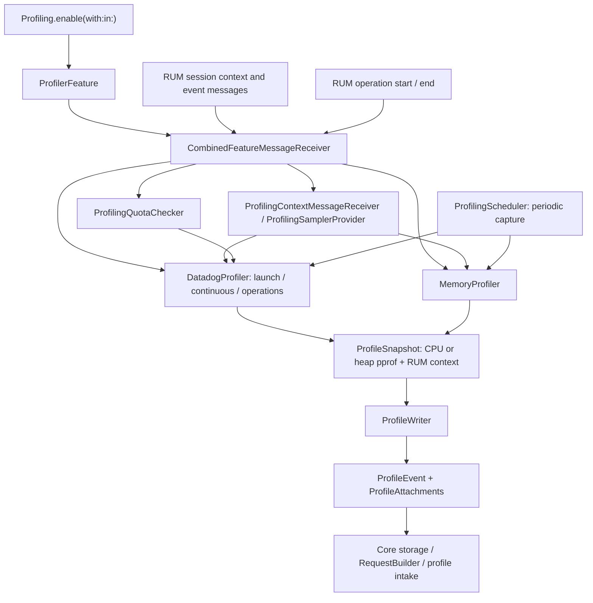

# Profiling Feature

## Overview

Profiling helps explain slow execution and memory growth in RUM sessions. CPU profiles show where application threads spend wall time and CPU time. Optional memory profiles estimate allocation activity and the class instances still alive at capture time.

- **Application launch profiling** captures startup through time to initial display (TTID).
- **Continuous CPU profiling** collects execution samples during selected RUM sessions.
- **Memory profiling** emits heap snapshots for separately selected RUM sessions. It is disabled by default and can run without CPU profiling.

Initialize Datadog, enable RUM, and then enable Profiling. Profiles require a sampled-in RUM session and correlated RUM events; enabling Profiling alone does not guarantee an upload. Profiling supports one SDK instance per process. Later enable calls keep the existing instance active and log an error.

**Platform**: iOS 15.0+, tvOS 15.0+, visionOS 1.0+. Profiling has no API on watchOS or macOS. The feature entry point and configuration support Swift and Objective-C.

## Quick Start Example

This example opts into memory tracking and selects 5% of sampled-in RUM sessions for heap profile emission. Outside SDK debug mode, omit `memorySampleRate`, or set it to `0`, to leave memory profiling disabled. Review [Memory Profiling](#memory-profiling) before opting in.

```swift
import DatadogCore
import DatadogRUM
import DatadogProfiling

// 1. Initialize the Core SDK before enabling RUM or Profiling.
Datadog.initialize(
    with: Datadog.Configuration(
        clientToken: "<client_token>",
        env: "<environment>"
    ),
    trackingConsent: .granted
)

// 2. Enable RUM to provide the session, view, and event correlations for profiles.
RUM.enable(
    with: RUM.Configuration(
        applicationID: "<rum_application_id>",
        uiKitViewsPredicate: DefaultUIKitRUMViewsPredicate(),
        uiKitActionsPredicate: DefaultUIKitRUMActionsPredicate(),

        // Profiles can include long tasks and app hangs when their RUM tracking is enabled.
        // Long task threshold in seconds. Default: 0.1.
        longTaskThreshold: 0.1,
        // App hang threshold in seconds. Default: nil (disabled).
        appHangThreshold: 2.0
    )
)

// 3. Enable Profiling. SDK debug mode overrides all three sample rates to 100%.
Profiling.enable(
    with: Profiling.Configuration(
        // Optional custom URL for profile uploads.
        // Default: nil, using the configured Datadog site.
        customEndpoint: nil,

        // CPU application launch profiling sample rate.
        // 100 = all launches eligible, 0 = launch profiling disabled.
        // Applies to the next process launch and also requires a sampled-in RUM session.
        // Default: 5.0.
        applicationLaunchSampleRate: 5.0,

        // Continuous CPU profiling sample rate, applied in addition to RUM session sampling.
        // 100 = all sampled-in RUM sessions eligible, 0 = continuous CPU profiling disabled.
        // Default: 5.0.
        continuousSampleRate: 5.0,

        // Memory profile emission sample rate, applied in addition to RUM session sampling.
        // 100 = all sampled-in RUM sessions eligible, 0 = memory profiling disabled.
        // Independent of the CPU rate; opting in enables runtime interception.
        // Default: 0.0 (disabled). This example explicitly opts in at 5%.
        memorySampleRate: 5.0
    )
)

let monitor = RUMMonitor.shared()

// 4. (Optional) Report TTFD when the launch content is fully displayed.
// Continuous CPU profiles can correlate with this full-display timing; this does not report TTID.
monitor.reportAppFullyDisplayed()

// 5. (Optional) Profile a RUM operation using the active CPU recording.
// Sampled operation steps do not start a stopped profiler or request a heap snapshot.
monitor.startOperation(
    name: "checkout_flow",
    operationKey: "cart-123",
    attributes: ["screen": "checkout"],
    // Applied in addition to RUM session sampling; 100 selects every eligible operation.
    options: ProfilingOptions(sampleRate: 100.0)
)

// Perform the work being measured.

// Complete the operation using the same name and operation key.
monitor.succeedOperation(
    name: "checkout_flow",
    operationKey: "cart-123",
    attributes: ["result": "success"]
)
```

Enable RUM early in application startup so launch profiling can correlate with TTID. Profiling launch settings take effect on the next process launch, so the first run after enabling the feature may not include startup samples.

### Objective-C

After initializing Core and enabling RUM, configure and enable Profiling through the Objective-C façade:

```objc
@import DatadogProfiling;

DDProfilingConfiguration *configuration = [[DDProfilingConfiguration alloc] init];
configuration.applicationLaunchSampleRate = 5.0;
configuration.continuousSampleRate = 5.0;
// Opt into memory profiling for 5% of sampled-in RUM sessions. Default: 0 (disabled).
configuration.memorySampleRate = 5.0;
// configuration.customEndpoint defaults to nil (Datadog intake).
[DDProfiling enableWith:configuration];
```

The configuration also supports `initWithCustomEndpoint:applicationLaunchSampleRate:continuousSampleRate:`. The CPU sample rates default to `5.0`, matching Swift; set the `memorySampleRate` property to opt into memory profiling. Use `[DDProfiling enableWith:configuration instanceName:@"my-instance"]` to select a named SDK instance; a `nil` name selects the default. Profiling still supports only one instance per process, so later enable calls preserve the existing feature.

## Architecture Overview

Profiling is one `DatadogRemoteFeature` named `profiler`. `Profiling.enable(with:in:)` applies the available remote configuration and registers `ProfilerFeature`, which composes separate CPU and memory profilers with a shared scheduler, writer, and upload pipeline.

RUM integration uses Core context and feature messages; `DatadogProfiling` does not import `DatadogRUM`. `ProfilingContextMessageReceiver` updates `ProfilingSamplerProvider` from the RUM session sampler before the profilers handle the context. `DatadogProfiler` owns application-launch, continuous, and custom/operation CPU profiling, while `MemoryProfiler` owns allocation tracking and heap captures. CPU quota admission is separate from memory sampling.

`ProfilingScheduler` requests periodic captures from both profilers on a common 60-second cadence. Each profiler owns its collection window and returns an owned `ProfileSnapshot`; launch and lifecycle captures can also be written independently. `ProfileWriter` combines compatible snapshots and RUM correlations into a `ProfileEvent` with `ProfileAttachments`. `RequestBuilder` uploads those attachments through the shared Profiling feature storage and upload path.

RUM operation start/end messages are handled by `DatadogProfiler`. During continuous profiling they correlate operations with the ongoing CPU profile. In custom operation mode, the CPU profiler also schedules captures around operation completion and its duration cutoff.



The native engines live in `DatadogProfiling/Mach`: CPU profiling samples thread stacks and CPU time; memory profiling samples supported allocations and tracks their lifetimes. Their C interfaces keep native ownership separate from Swift orchestration. Saved configuration enables collection before SDK initialization on a later process launch. Once enabled, memory recording continues across background and sampled-out periods; consent, shutdown, and failure handling control whether it remains active.

`DatadogProfiler` publishes `ProfilingContext` into Core so RUM can report CPU profiling status and quota information. That status does not describe the independent memory recorder.

## Capture Semantics and RUM Correlation

Continuous CPU and heap captures share a 60-second cadence. Their collection intervals can differ, particularly when recording starts or resumes at different times. A shared upload preserves each profile's time semantics.

Periodic CPU captures require a recording window of at least five seconds. If the next capture is due sooner, CPU recording continues until a later periodic capture. Heap snapshots continue independently and do not use this minimum.

| Profile data | Time semantics | Event-range selection |
|---|---|---|
| CPU/wall-time samples | Individual timestamped samples across the collection interval | Samples can be selected within a RUM event's time range. |
| Heap `inuse_objects` / `inuse_space` | Estimated live object counts and bytes from sampled allocations at capture end, including surviving allocations from earlier windows | Cannot reconstruct the live heap during an earlier event. |
| Heap `alloc_objects` / `alloc_space` | Estimated allocation totals across the collection interval | Cannot select an event-sized subinterval because individual allocation timestamps are not exported. |

One heap profile contains both allocation totals and live-memory estimates. The live-heap snapshot represents the end of its own collection interval.

When CPU and heap data appear together, selecting a RUM event's time range applies to the CPU samples. The heap data remains a complete capture. Profiles require RUM correlation data even when only memory profiling is running.

RUM association provides navigation and surrounding context for a heap snapshot. It does not establish the heap contents during an earlier event or attribute allocations to that event. For example, a snapshot at 60 seconds cannot reconstruct the live heap during a long task at 20 seconds. App-launch heap captures are triggered by TTID, providing context at that launch boundary.

## Key Files

### Feature Entry Point and Composition

- **`DatadogProfiling/Sources/Profiling.swift`** — public enable API, configuration merge, and registration with Core.
- **`DatadogProfiling/Sources/Profiling+objc.swift`** — Objective-C entry point (`DDProfiling`) and configuration wrapper (`DDProfilingConfiguration`). Both enable methods forward to the Swift entry point.
- **`DatadogProfiling/Sources/ProfilerFeature.swift`** — composes the CPU and memory profilers, shared capture/upload components, message receivers, and saved launch settings.

### Configuration and Sampling

- **`DatadogProfiling/Sources/ProfilingConfiguration.swift`** — public endpoint and sampling configuration, including remote overrides.
- **`DatadogInternal/Sources/Models/Profiling/ProfilingOptions.swift`** — public sampling options used for RUM operation correlation.
- **`DatadogProfiling/Sources/ProfilingSamplerProvider.swift`** — CPU launch/session decisions and the separate memory session decision.
- **`DatadogProfiling/Sources/ProfilingContextMessageReceiver.swift`** — updates sampling decisions from RUM session context.

### Runtime Orchestration

- **`DatadogProfiling/Sources/DatadogProfiler.swift`** — CPU application-launch, continuous, and custom/operation profiling, including operation lifecycle, event correlation, and CPU status.
- **`DatadogProfiling/Sources/Models/ProfilingOperation.swift`** — application-launch, continuous, and custom profiling mode identifiers.
- **`DatadogProfiling/Sources/MemoryProfiler.swift`** — memory recording, launch capture, session/window boundaries, and heap emission.
- **`DatadogProfiling/Sources/Models/ProfilingConditions.swift`** — battery, Low Power Mode, and background eligibility checks.
- **`DatadogProfiling/Sources/ProfilingQuotaChecker.swift`** — CPU session quota requests and admission decisions.

### Capture, Storage, and Upload

- **`DatadogProfiling/Sources/ProfilingScheduler.swift`** — common periodic capture cadence for CPU and memory.
- **`DatadogProfiling/Sources/Models/ProfileSnapshot.swift`** — captured pprof data, its time bounds, and its RUM correlation context.
- **`DatadogProfiling/Sources/ProfileWriter.swift`** — shared event writing, CPU-preferred RUM correlation, and separate writes for incompatible sessions or oversized combined captures.
- **`DatadogProfiling/Sources/ProfileEvent.swift`** — upload metadata and RUM identifiers.
- **`DatadogProfiling/Sources/Models/ProfileAttachments.swift`** — CPU/heap pprof and RUM event attachments persisted with the profile event.
- **`DatadogProfiling/Sources/RequestBuilder.swift`** — multipart profile upload request.
- **`DatadogProfiling/Sources/SDKMetrics/ProfilingTelemetryController.swift`** — profiling configuration, capture, and drop diagnostics.

### Native Profilers

- **`DatadogProfiling/Mach/dd_profiler.cpp`** — CPU profiler lifecycle and early launch entry points.
- **`DatadogProfiling/Mach/mach_sampling_profiler.cpp`** — native thread-stack sampling.
- **`DatadogProfiling/Mach/memory_profiler.cpp`** — shared native memory lifecycle, interception startup, and heap capture.
- **`DatadogProfiling/Mach/objc_alloc_hook.cpp`** — Objective-C allocation and deallocation interception.
- **`DatadogProfiling/Mach/swift_alloc_hook.cpp`** — Swift runtime allocation and deallocation interception.
- **`DatadogProfiling/Mach/memory_allocation_window.cpp`** — per-window allocation totals and live-set snapshots.
- **`DatadogProfiling/Mach/memory_live_set.cpp`** — sampled object lifetime tracking.
- **`DatadogProfiling/Mach/memory_pprof.cpp`** — heap pprof encoding.

## Configuration Categories

### Sampling

All sampling rates accept values from `0.0` to `100.0`. Outside SDK debug mode, zero disables that profiling mode. CPU and memory session decisions use the RUM session sample rate in addition to their own configured rates.

| Setting | Default | Effect |
| --- | --- | --- |
| `applicationLaunchSampleRate` | `5.0` | Selects application launches for CPU startup profiling. Takes effect on the next process launch; the launch profile also requires an eligible RUM session. |
| `continuousSampleRate` | `5.0` | Selects RUM sessions for continuous CPU profiling. |
| `memorySampleRate` | `0.0` | Enables memory tracking when positive and selects RUM sessions for heap emission. Also enables early memory collection on the next process launch. |

For example, a RUM session rate of 80% and a memory rate of 5% select approximately 4% of all sessions for heap profile emission. CPU and memory have separate rates: a session can collect memory profiles while CPU profiling is sampled out, or the reverse.

A positive `memorySampleRate` enables allocation/free tracking across sessions, including sessions not selected for heap emission. The rate controls emitted sessions; it does not reduce the allocation sampling frequency or restrict recording to those sessions.

SDK debug mode raises all three profiling rates to 100%, including memory profiling.

### Upload Endpoint

`customEndpoint` defaults to `nil`, which sends profiles to the Datadog site selected in `Datadog.Configuration`. Set it only when profiles should use a custom upload URL.

### Tracking Consent and Runtime Conditions

With `.pending` consent, profiles can be collected and stored locally while upload waits for consent. Granting consent permits upload; setting consent to `.notGranted` stops collection and discards pending data.

CPU collection and periodic heap emission pause while the app is in the background, Low Power Mode is enabled, or the battery is below 10% and not charging. Eligible foreground data can be captured when the app backgrounds.

With a positive memory rate, allocation and free tracking continue while emission is paused or a session is sampled out, preserving live-object information. Background allocations can therefore appear in a later foreground heap window. Revoking consent stops tracking and discards the current window.

### CPU Profiling Quota

CPU profiling also depends on session quota admission. Explicit quota rejection stops CPU profiling for that session; a new session receives a new decision. Temporary quota lookup failures do not block CPU profiling. Memory profiling is independent of this CPU quota.

## RUM Correlation

| RUM event | CPU profiles | Heap profiles |
| --- | --- | --- |
| Time to initial display (TTID) | Correlates application startup. | Correlates a launch heap snapshot when early memory collection is available and the memory session decision admits emission. |
| Time to full display (TTFD) | Can be attached to a continuous CPU profile. | Does not independently trigger or correlate a heap snapshot. |
| Sampled operation steps | Can be attached to an active CPU profile. | Do not independently trigger or correlate a heap snapshot. |
| App hangs and long tasks | Can be attached when they overlap collected CPU samples. | Can be attached when they overlap the heap collection window. |

App hangs and long tasks are included in captured windows; receiving one does not immediately trigger a separate profile. RUM memory warnings do not currently trigger a heap snapshot either. Combined uploads use CPU RUM events and attributes when available; heap correlations are used when CPU supplies none. The event range can select CPU samples but cannot select a slice of the heap capture.


## Exploring Profiles

Open a profile from its correlated RUM event to investigate execution during a slow launch, app hang, long task, or operation. CPU profiles show execution over time; heap profiles show which supported classes and allocation stacks account for allocation activity or retained objects. See [Correlate RUM and Profiling](https://docs.datadoghq.com/real_user_monitoring/correlate_with_other_telemetry/profiling/) for the profile exploration workflow.

Readable application stack frames require symbols matching the profiled build. Upload the app's matching dSYM files to Datadog; missing symbols can leave application frames as addresses. See the [iOS dSYM upload instructions](https://docs.datadoghq.com/real_user_monitoring/application_monitoring/ios/error_tracking/#upload-your-dsym-files).

## Memory Profiling

### Opt-In and Coverage

Memory profiling observes supported Objective-C and Swift class allocations and deallocations. Opting in enables runtime interception, which can interact with other instrumentation, similar to RUM automatic instrumentation. If memory profiling cannot initialize or capture successfully, it stops without disabling RUM or CPU profiling.

Heap profiles contain sampled estimates grouped by allocation stack and class. They cover class-instance storage, rather than every allocation made by the process. Swift value-type backing buffers such as `Array`, `Dictionary`, `String`, and `Data`, raw C/C++ allocations, and large virtual-memory buffers are outside this coverage. Class names are best effort and may include private Foundation class-cluster names.

### Reading Heap Values

| Value | Meaning |
| --- | --- |
| `alloc_objects` | Estimated number of supported objects allocated during the collection window. |
| `alloc_space` | Estimated instance bytes allocated during the collection window. |
| `inuse_objects` | Estimated number of supported objects still alive at capture time. |
| `inuse_space` | Estimated instance bytes still alive at capture time; the default heap sample type. |

Use `alloc_*` to investigate allocation churn and `inuse_*` to investigate retained growth. Counts and bytes are scaled estimates, so a profile is not an exact object census. Small populations may not be sampled, and bounded collection can drop samples under heavy load.

Heap totals do not represent the app's total memory footprint and should not be expected to match the RUM memory usage curve. Instance bytes exclude backing storage and other memory reachable from an object.

### Launch and Session Boundaries

Early launch collection uses the previous process's memory configuration. Emitting a launch heap profile requires the current memory rate composed with RUM session sampling, plus foreground eligibility. TTFD does not replace TTID for this launch capture.

At a RUM session or sampling boundary, allocation activity is closed for the ending context so its allocation totals do not carry into the next window. Allocation/free tracking and the live set continue across sampled-out sessions, allowing a later sampled-in profile to include objects that survived those sessions. Revoking consent or shutting down memory recording clears that state.

## Remote Configuration

When `Datadog.Configuration.remoteConfiguration` is configured, a cached or already-fetched remote document can override `applicationLaunchSampleRate` and `continuousSampleRate` at `Profiling.enable(with:)` time. Omitted values preserve the in-code settings.

The merge happens once when Profiling is enabled. Later remote refreshes do not change an already-running feature. `memorySampleRate` currently uses only the in-code value and cannot be remotely changed or disabled.

## Common Troubleshooting Patterns

### No Profiles Appear

1. Initialize Datadog, enable RUM, and then enable Profiling on the intended SDK instance.
2. Check that the relevant rate is above zero and that RUM session sampling admits the session.
3. Grant tracking consent for uploads, and check foreground, battery, and Low Power Mode conditions.
4. Ensure the window includes supported RUM correlations. A periodic capture alone does not guarantee an upload.
5. For CPU profiles, check whether the session was rejected by quota. Memory profiling is independent of that decision.

### CPU Collection Runs but No Continuous Profile Is Uploaded

A CPU window needs correlated RUM events: TTFD, sampled operation steps, app hangs, or long tasks. Report TTFD when the app is fully displayed, correlate operations while CPU profiling is active, or enable RUM long task/app hang tracking as appropriate. Sampling and an elapsed capture interval alone do not guarantee an upload.

### CPU Profiles Appear but Heap Profiles Are Missing

Set `memorySampleRate` above zero for normal use; SDK debug mode overrides it to 100%. For heap-only uploads after launch, enable RUM long task or app hang tracking. TTFD and operation steps alone do not provide independent heap correlations. A window without observed allocations or live-set changes may also produce no heap data.

### A RUM Operation Has No Profile

Pass `ProfilingOptions(sampleRate:)` when starting the operation, and confirm that both the RUM session and operation sampling decisions admit it. Complete the operation with the matching name and key. CPU recording must be active and allowed by consent, quota, and runtime conditions; starting an operation does not restart a stopped profiler.

### Application Launch Profiles Are Missing

Launch configuration applies to the next process launch. Enable RUM early enough to report TTID, and confirm the launch and RUM session were both admitted. Calling `reportAppFullyDisplayed()` reports TTFD and does not replace TTID. System prewarming can prevent an ordinary launch profile.

### Profiles Stop When the App Backgrounds

CPU collection and periodic heap emission pause in the background. When memory tracking is enabled, allocation/free observation continues, including across sampled-out sessions, so live-object information survives until eligible foreground emission resumes.

## Feature Interactions

- **RUM** supplies session sampling, application/session/view context, and the supported event correlations. Enable long task or app hang tracking when those correlations are needed.
- **Tracking consent** controls local storage and upload, as well as stopping collection when consent is not granted.
- **Remote Configuration** can override the two CPU rates when Profiling is enabled; memory sampling remains configured in code.

## Additional Context

- CPU profiles contain wall-time and CPU-time values. Heap profiles contain the four allocation/live-object values above. They are complementary views of application behavior.
- Profiling produces pprof data. CPU and heap data can share an upload, and a heap profile does not require a CPU attachment.
- CPU profiling stops for the remainder of the process after a profiler memory-allocation failure. Memory initialization or capture failures disable that memory profiler for the remainder of its lifetime.
- There is no public API to request an immediate heap snapshot or independently start/stop a profiling mode after enabling the feature.
