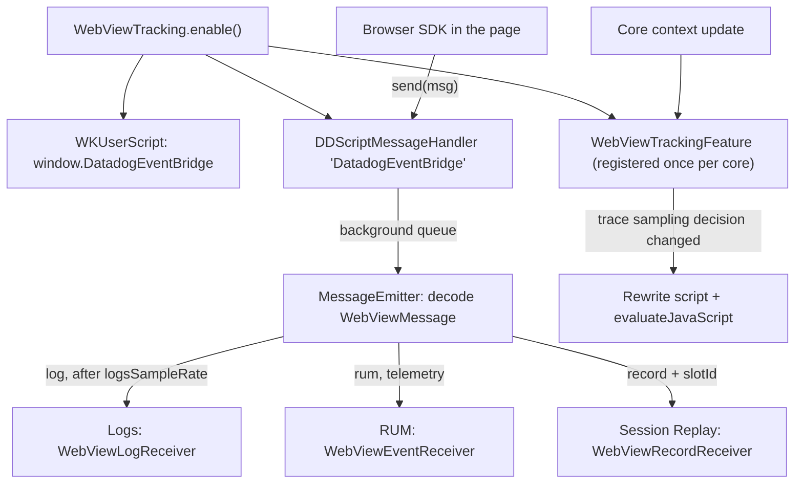

# WebView Tracking Feature

## Overview

WebView Tracking connects a `WKWebView` running the Datadog Browser SDK to the native SDK. It injects a JavaScript bridge (`window.DatadogEventBridge`) into the WebView. Browser SDK sends its RUM events, logs, telemetry, and Session Replay records through that bridge, and the native SDK writes them in the native RUM session, with native IDs, tags, and server time offset.

WebView Tracking has no upload path of its own. Each event type needs its native feature: RUM events and telemetry need RUM, logs need Logs, and records need Session Replay and RUM. RUM events, telemetry, and records are dropped when the native RUM session is sampled out. Call `Datadog.initialize()` before `WebViewTracking.enable()`. The web page must be instrumented with Browser SDK (see [Browser SDK Versions](#browser-sdk-versions)).

**Platform**: iOS, visionOS. Through SPM, the module also builds on tvOS, macOS, and watchOS:
- **visionOS**: Session Replay is not available, so no web records are captured.
- **macOS**: `enable` and `disable` are available for AppKit `WKWebView`s. Session Replay is iOS-only, so no web records are captured.
- **tvOS / watchOS**: WebKit is not available. `WebViewTracking` has no `enable` or `disable` there. Only the cross-platform message emitter is compiled.

## Quick Start Example

```swift
import WebKit
import DatadogCore
import DatadogRUM
import DatadogLogs
import DatadogSessionReplay
import DatadogWebViewTracking

Datadog.initialize(
    with: Datadog.Configuration(clientToken: "<client_token>", env: "<environment>"),
    trackingConsent: .granted
)

// Required for web RUM events. Web events are dropped when the native session is sampled out.
RUM.enable(
    with: RUM.Configuration(
        applicationID: "<rum_application_id>",
        // Optional: sets the trace sampling decision shared with Browser SDK.
        urlSessionTracking: RUM.Configuration.URLSessionTracking(
            firstPartyHostsTracing: .trace(hosts: ["api.example.com"], sampleRate: 20)
        )
    )
)

// Required for web logs.
Logs.enable()

// Optional, iOS only: records web content in native replays. Enable it before `WebViewTracking.enable()`.
SessionReplay.enable(
    with: SessionReplay.Configuration(
        replaySampleRate: 100,
        // These three levels are converted into one web privacy level (see Session Replay Privacy).
        textAndInputPrivacyLevel: .maskSensitiveInputs,
        imagePrivacyLevel: .maskNone,
        touchPrivacyLevel: .show
    )
)

let webView = WKWebView(frame: .zero, configuration: WKWebViewConfiguration())

// Call once per WebView, before loading the page. Runs synchronously on the main thread.
WebViewTracking.enable(
    webView: webView,
    // Hosts or single-`*` wildcard patterns instrumented with Browser SDK. URLs are reduced to their host,
    // invalid entries are dropped, each with a console warning. Default: [].
    hosts: ["example.com", "*.example.com"],
    // Percentage of web logs kept, 0...100. Applies to logs only. Default: 100.
    logsSampleRate: 100,
    // SDK instance to send events to. Default: CoreRegistry.default.
    in: CoreRegistry.default
)

webView.load(URLRequest(url: URL(string: "https://example.com")!))

// Before releasing the WebView:
WebViewTracking.disable(webView: webView)
```

### Objective-C

```objc
@import DatadogWebViewTracking;

[DDWebViewTracking enableWithWebView:webView
                               hosts:[NSSet setWithArray:@[@"example.com"]]
                      logsSampleRate:100];

// On a named SDK instance (`nil` uses the default instance):
[DDWebViewTracking enableWithWebView:webView
                        instanceName:@"my-instance"
                               hosts:[NSSet setWithArray:@[@"example.com"]]
                      logsSampleRate:100];

[DDWebViewTracking disableWithWebView:webView];
```

`DDWebViewTracking` is declared with `@_spi(objc)`, so Swift code needs `@_spi(objc) import DatadogWebViewTracking` to see `objc_WebViewTracking`.

## Architecture Overview



1. **Enable**: `enable` runs synchronously on the main thread. It adds a `WKScriptMessageHandler` named `DatadogEventBridge` and a user script injected at document start in all frames (`forMainFrameOnly: false`). The script defines `window.DatadogEventBridge` with `send` and four getters, which all return strings:
   - `send(msg)`: forwards to `window.webkit.messageHandlers.DatadogEventBridge.postMessage`.
   - `getAllowedWebViewHosts()`: the sanitized `hosts`, as a JSON array.
   - `getCapabilities()`: `["records"]` when Session Replay is enabled, `[]` otherwise.
   - `getPrivacyLevel()`: `allow`, `mask`, or `mask-user-input` (see [Session Replay Privacy](#session-replay-privacy)).
   - `getIsTraceSampled()`: `true`, `false`, or `null` (see [Trace Sampling](#trace-sampling)).
2. **Bridge mode**: Browser SDK uses the bridge only when the page host matches an entry of `getAllowedWebViewHosts()` (see [Hosts](#hosts)). In bridge mode, it sends everything to `send` instead of uploading, forces its `sessionSampleRate` to `100` (native sampling decides), and defaults `service` to the web application ID. Otherwise it runs as a standalone Browser SDK, with its own sampling and uploads.
3. **Receive**: `DDScriptMessageHandler` reads the message body on the main thread, then hands it to `MessageEmitter` on a serial background queue (one per WebView), with the WebView's `hash` as the `slotId` (`nil` when the message has no WebView).
4. **Decode**: `MessageEmitter` decodes the body as a `WebViewMessage` with `eventType` and `event` fields (`view` too for records). It sends the message on the message bus:
   - `log` → Logs, after the `logsSampleRate` sampler.
   - `rum`, `view`, `action`, `resource`, `error`, `long_task` → RUM, as `.rum`.
   - `internal_telemetry` → RUM, as `.telemetry`.
   - `record` → Session Replay, with `slotId` added to the record.
5. **Session rollover**: `WebViewTrackingFeature` listens for core context messages. When the trace sampling decision changes, it rewrites the user script of every tracked WebView and runs JavaScript that updates `getIsTraceSampled` in the loaded page and its same-origin frames. Cross-origin frames get the new value on their next load.

## Key Files

### Public API
- `DatadogWebViewTracking/Sources/WebViewTracking.swift` — `WebViewTracking.enable(webView:hosts:logsSampleRate:in:)`, `disable(webView:)`, the injected bridge script, the privacy level conversion, the trace sampling decision, and `WebViewTracking._internal.messageEmitter(in:logsSampleRate:)`.
- `DatadogWebViewTracking/Sources/ObjC/WebViewTracking+objc.swift` — `DDWebViewTracking` (`objc_WebViewTracking`), the Objective-C bridge.
- `DatadogInternal/Sources/Models/WebViewTracking/WebViewMessage.swift` — `WebViewMessage`, the bridge message format and its event type mapping.

### Implementation
- `DatadogWebViewTracking/Sources/DDScriptMessageHandler.swift` — `WKScriptMessageHandler` that receives bridge messages and dispatches them off the main thread.
- `DatadogWebViewTracking/Sources/MessageEmitter.swift` — Decodes messages, applies `logsSampleRate`, and routes them on the message bus.
- `DatadogWebViewTracking/Sources/WebViewTrackingFeature.swift` — Feature registered on first `enable`. Its message receiver detects trace sampling changes.
- `DatadogWebViewTracking/Sources/WebViewSessionRolloverHandler.swift` — Weak registry of tracked WebViews, per core, updated on session rollover.
- `DatadogInternal/Sources/NetworkInstrumentation/HostsSanitizer.swift` — Validation of `hosts` entries, shared with RUM first-party hosts.
- `DatadogRUM/Sources/Integrations/WebViewEventReceiver.swift` — Writes web RUM events and telemetry in the native session.
- `DatadogLogs/Sources/Feature/MessageReceivers.swift` — `WebViewLogReceiver`, writes web logs.
- `DatadogSessionReplay/Sources/Feature/WebViewRecordReceiver.swift` — Writes web replay records.
- `DatadogSessionReplay/Sources/Recorder/ViewTreeSnapshotProducer/ViewTreeSnapshot/NodeRecorders/WKWebViewRecorder.swift` — Native wireframe (slot) for each `WKWebView` in the replay.

## Configuration Categories

### Hosts
- `hosts` (default: `[]`) is passed to Browser SDK through `getAllowedWebViewHosts()`. Browser SDK does the matching against `location.hostname`:
  - A plain entry matches the host itself and its subdomains (`example.com` matches `shop.example.com`).
  - A wildcard entry matches a host that starts with the part before `*`, ends with the part after it, and has at least one character in between (`preview-*.example.com` matches `preview-1.example.com`, not `preview-.example.com`).
  - With an empty list, no page uses the bridge.
- Each entry is validated with `HostsSanitizer`:
  - A plain host name or an IPv4 address is kept as is.
  - A URL is replaced by its host, with a warning (`https://example.com/path` → `example.com`).
  - A wildcard pattern must have exactly one `*`, contain a `.`, have a `.` and at least one more character right after the `*`, and use only `a-z`, `0-9`, `.`, `-`, and `*` (case-insensitive). Valid patterns are lowercased (`*.example.com`, `preview-*.shopist.io`). Other patterns are dropped.
  - Any other entry is dropped.
  - Each replaced or dropped entry prints a console warning that contains `The allowed WebView host configured for Datadog SDK is not valid`.
- Hosts are fixed for the WebView's lifetime. To change them, call `disable` then `enable` again.

### Logs Sampling
- `logsSampleRate` (default: `100`, range `0...100`) keeps a random percentage of web logs. Each log is sampled on its own, before it reaches the message bus.
- It has no effect on RUM events, telemetry, or replay records. They follow the native RUM session sampling.

### Session Replay Privacy
The bridge passes one global privacy level for web content, so the native fine-grained levels are converted:

| `textAndInputPrivacyLevel` | `imagePrivacyLevel` | `touchPrivacyLevel` | Web privacy level |
|---|---|---|---|
| `.maskSensitiveInputs` | `.maskNone` | `.show` | `allow` |
| `.maskAllInputs` | `.maskNone` | `.show` | `mask-user-input` |
| Any other combination | | | `mask` |

- The page's own `defaultPrivacyLevel` in its Browser SDK init configuration takes precedence over `getPrivacyLevel()`.
- Without Session Replay, the level is `mask` and `getCapabilities()` returns `[]`, so Browser SDK turns its recording off. This includes `replaySampleRate: 0`, in code or from Remote Configuration, which leaves Session Replay unregistered.
- Levels are read from the Session Replay feature when `enable` runs, and again on each trace sampling update. With `Datadog.Configuration.remoteConfiguration`, they include the remote overrides that Session Replay applied at its own `enable`.
- Enabling Session Replay after `WebViewTracking.enable()` does not update `getCapabilities()` or `getPrivacyLevel()` until the bridge script is rewritten on a trace sampling change, and then only for pages loaded after the rewrite.

### Trace Sampling
`getIsTraceSampled()` shares the native trace sampling decision with Browser SDK:
- `'null'`: RUM is not enabled, RUM `urlSessionTracking.firstPartyHostsTracing` is not configured, or no RUM session is active (for example, after `stopSession()`). Browser SDK then uses its own decision, from its session and `traceSampleRate`.
- `'true'` or `'false'`: the RUM session decision combined with the `firstPartyHostsTracing` sample rate. The decision is read from RUM's sampling store, so it is available right after `RUM.enable()` returns.
- The `firstPartyHostsTracing` hosts do not need to match the WebView `hosts`.
- When a web RUM event has `_dd.rule_psr` and `firstPartyHostsTracing` is configured, RUM replaces it with the native `firstPartyHostsTracing` sample rate, as a proportion (`0...1`).

### Browser SDK Versions
WebView tracking needs Browser SDK `v4.5.0+`. From the Browser SDK changelog, other bridge features need these versions:
- Subdomain matching of plain hosts: `v4.8.0`.
- Session Replay records (`records` capability): `v5.11.0`.
- Trace sampling decision (`getIsTraceSampled`): `v7.1.0`.
- Wildcard host patterns: `v7.3.0`, with the "at least one character" rule from `v7.4.0`.

### Cross-Platform Message Emitter (`_internal`)
`WebViewTracking._internal.messageEmitter(in:logsSampleRate:)` returns an `AbstractMessageEmitter` whose `send(body:slotId:)` accepts the bridge message JSON string. Cross-platform SDKs use it when they own the WebView bridge. It applies the same decoding, logs sampling, and routing as `enable`, but injects no script and does not register the WebView for trace sampling updates. It is compiled on every platform, including tvOS and watchOS. `_internal` is not a supported customer API.

## Common Troubleshooting Patterns

### "No web events in the native session"
**Causes:**
- The page does not run Browser SDK, or its host does not match `hosts` (empty by default). Wildcard entries need Browser SDK `v7.3.0+`.
- `enable` was called before `Datadog.initialize()`. The console shows an SDK usage error (`Datadog SDK must be initialized before calling ...`), and the WebView is not tracked. The same happens with the Objective-C `instanceName` overload when no instance has that name.
- RUM is not enabled. The SDK logger warns `A WebView RUM event is lost because RUM is disabled in the SDK` (visible only with `Datadog.verbosityLevel` set).
- The native RUM session is sampled out. RUM events, telemetry, and records are dropped without a warning, and logs get no RUM IDs.
- The page was loaded before `enable`. The user script is injected at document start, so it applies from the next navigation.
- The bridge message could not be decoded. The SDK logs `Encountered an error when receiving web view event` and sends it as telemetry.

**Solutions:** Initialize the SDK and enable RUM before `WebViewTracking.enable()`, call `enable` before loading the page, check `hosts`, and set `Datadog.verbosityLevel = .debug` to see the SDK warnings.

### "Web logs are missing"
**Causes:** Logs is not enabled (`A WebView log is lost because Logging is disabled in the SDK`), or `logsSampleRate` dropped them. Web logs do not need RUM. Without a sampled RUM session, they are sent without RUM IDs.

**Solutions:** Call `Logs.enable()` and check `logsSampleRate`.

### "Web content is missing or blank in Session Replay"
**Causes:**
- Session Replay was not enabled when `WebViewTracking.enable()` ran, so the bridge reports no `records` capability.
- Session Replay is disabled. The SDK logger warns `A WebView Replay record is lost because Session Replay is disabled in the SDK`.
- The native privacy levels convert to `mask`, or the page sets its own `defaultPrivacyLevel`. See [Session Replay Privacy](#session-replay-privacy).
- The page runs Browser SDK older than `v5.11.0`.
- The app runs on macOS or visionOS, where Session Replay is not available.

**Solutions:** Enable Session Replay before `WebViewTracking.enable()`, and check the privacy table.

### "Web content is masked though native content is not"
**Expected.** Only two exact combinations unmask web content. For example, `.maskSensitiveInputs` text with `.maskAll` images makes the whole web view `mask`.

### "Warning: `WebViewTracking.enable(webView:hosts:)` was called more than once for the same WebView"
`enable` checks for the bridge user script and ignores a second call on the same WebView. The SDK logger prints this warning, so it needs `Datadog.verbosityLevel`. To change `hosts` or `logsSampleRate`, call `disable` first.

## Feature Interactions

- **RUM**: Receives web RUM events and telemetry. For RUM events, `WebViewEventReceiver` keeps the native session alive (even when the event is then dropped as sampled out), replaces `application.id` and `session.id` with native values, merges native `ddtags`, applies the server time offset per web RUM view ID, and adds `usr.anonymous_id`. It sets `session.is_main_process` and `session.has_timeseries`. When native replay is off, it sets `session.has_replay` to `false` (or removes it) and removes `_dd.replay_stats`. It also adds a `container` with the native view ID, from the most recent native view with Session Replay that started before the event. For telemetry, it only replaces `application.id` and `session.id` and applies the core server time offset. RUM event mappers do not apply to web events.
- **Logs**: Receives web logs. `WebViewLogReceiver` merges native `ddtags`, applies the server time offset, adds `usr.anonymous_id`, and adds the RUM application, session, view, and action IDs when the RUM session is sampled. `Logs.Configuration.eventMapper` and Logs global attributes do not apply to web logs.
- **Session Replay**: Receives web records with the native RUM application and session IDs and the web RUM view ID. The record timestamp gets the server time offset that RUM stored for that web RUM view, if any. `slotId` (the `WKWebView` `hash`) matches the WebView's wireframe in the native replay.
- **Trace**: Not involved directly. The trace sampling decision comes from RUM `urlSessionTracking.firstPartyHostsTracing`.
- **Tracking consent**: Web events are written like native events, so they follow the SDK tracking consent.
- **Telemetry**: Each successful `enable` sends a `trackWebView` usage telemetry event.
- **Multiple SDK instances**: Each core has its own `WebViewTrackingFeature` and WebView registry. `disable` finds the right core for the WebView on its own.

## Additional Context

- `WebViewTracking` has no configuration object or `Feature.enable()` call. `WebViewTrackingFeature` is registered on the first `enable` call for a core.
- `disable` removes the `DatadogEventBridge` handler and the bridge user script, keeps other user scripts, and stops trace sampling updates for the WebView. Call it before the WebView is deinitialized. The registry holds WebViews weakly.
- `enable` and `disable` can be called from any thread. Off the main thread, they block on `DispatchQueue.main.sync`, so calling them from a thread the main thread waits on deadlocks.
- The bridge never sends the session ID or other native context to the page. It only exposes the four getters and `send`. It does not advertise the `profiles` capability, so Browser SDK profiling does not run in tracked WebViews.
- Tracked WebViews are updated on the first context message after the feature is registered, then only when the decision string changes.
