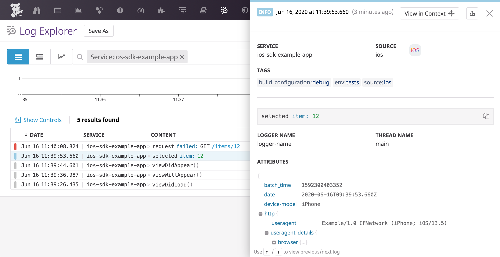
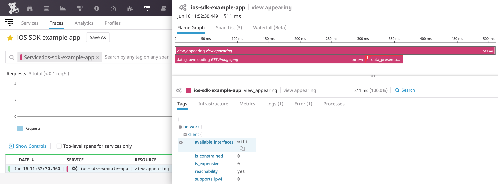
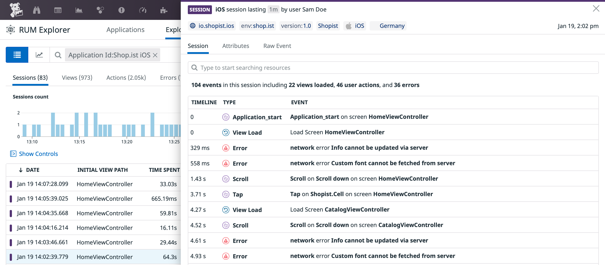

    
    
    
    

# Datadog SDK for iOS, tvOS, and macOS

> Swift and Objective-C libraries to interact with Datadog on iOS, tvOS, and macOS.

## Getting Started

### Log Collection

See the dedicated [Datadog iOS Log Collection][1] documentation to learn how to send logs from your iOS application to Datadog.

### Trace Collection

See [Datadog iOS Trace Collection][2] documentation to try it out.

### RUM Events Collection

See [Datadog iOS RUM Collection][3] documentation to try it out.

#### WebView Tracking

RUM allows you to monitor web views and eliminate blind spots in your hybrid mobile applications. See [WebView Tracking][5] documentation to try it out.

### macOS

Native AppKit and SwiftUI apps on macOS 12.0 and later, on Apple silicon and Intel, are supported through Swift Package Manager. RUM, Logs, Trace, Crash Reporting, WebView Tracking, and Feature Flags are available. Session Replay and Profiling are not available on macOS, and Mac Catalyst apps are not supported.

## Integrations

If you use [Alamofire][7], [Apollo GraphQL][8], [SDWebImage][9], or [OpenAPI Generator][10], see [Integrated Libraries][4] to learn how to instrument requests automatically.

For Apollo iOS 2.x, enable the `Apollo` Swift package trait to use the integration through `DatadogCore`. See the [Apollo integration guide](APOLLO_INTEGRATION.md) for setup and migration from the standalone interceptor package.

### Swift package traits

| Trait | Default | Enables |
|------|---------|---------|
| `CrashReporting` | Enabled | The built-in KSCrash reporter in `DatadogCrashReporting` |
| `OpenTelemetry` | Enabled | The OpenTelemetry API adapters in `DatadogTrace` |
| `Apollo` | Disabled | The Apollo iOS 2 integration exposed through `DatadogCore` |

Keep default integrations and add Apollo with `traits: [.defaults, "Apollo"]` on your
`dd-sdk-ios` package dependency. Select individual traits explicitly, or use
`traits: []` to build without these external integrations. Without `OpenTelemetry`,
native tracing through `Tracer.shared()` remains available. Without `CrashReporting`,
the custom `CrashReportingPlugin` API remains available, but `CrashReporting.enable()`
with the built-in reporter does not. CocoaPods and the Xcode framework targets keep
their existing integrations.

Traits control compilation and linking; depending on the SwiftPM version, disabled
dependencies may still participate in package resolution.

## Contributing

Pull requests are welcome. First, open an issue to discuss what you would like to change. For more information, read the [Contributing Guide](CONTRIBUTING.md).

## License

[Apache License, v2.0](LICENSE)

## Supported Versions

See the [Supported Versions][6] documentation for more details.

[1]: https://docs.datadoghq.com/logs/log_collection/ios
[2]: https://docs.datadoghq.com/tracing/setup_overview/setup/ios
[3]: https://docs.datadoghq.com/real_user_monitoring/ios
[4]: https://docs.datadoghq.com/real_user_monitoring/mobile_and_tv_monitoring/integrated_libraries/ios
[5]: https://docs.datadoghq.com/real_user_monitoring/mobile_and_tv_monitoring/web_view_tracking?tab=ios
[6]: https://docs.datadoghq.com/real_user_monitoring/mobile_and_tv_monitoring/supported_versions/ios/
[7]: https://github.com/Alamofire/Alamofire
[8]: https://github.com/apollographql/apollo-ios
[9]: https://github.com/SDWebImage/SDWebImage
[10]: https://github.com/OpenAPITools/openapi-generator
